# dae 界面重构方案 · 石墨（Graphite）

> 日期：2026-11-14 · 状态：**已定稿**（四条关键决策已于 2026-11-14 评审确定，见 §14；本文不含实现代码）
> 对象：`qml/` 全部 56 个文件、`crates/dae-qt` 的模型与桥接、`crates/dae-core` 的数据角色
> 取代：`docs/ui-ux-2026.md`、`docs/ui-instrument-migration.md`、`docs/ui-drift-migration.md`
> 本文的数值是可以直接落地的执行值，不是示意图。配色、对比度、行高、字号均由脚本推导并实测（§6.1、§13.5）。

---

## 0. 结论

现状的问题不是"不好看"，是**三代皮肤都没有回答"一个每天开着的文件管理器应该长什么样"**。

- 第一代（React/WebView 壳）：中性灰 + 暖橙信号色，结构对、气质平。
- 第二代（仪器感）：等宽、发丝线、116 px 三段外壳，信息密度对、缺少层次。
- 第三代（drift 纸张）：衬线大标题、纸纹、硬投影、便利贴、序号、实心黑图标。**它是风格化最重的一代，也是与"每天用、不能审美疲劳"最冲突的一代。**

同一套骨架被换了三次皮：标题行 + 导航行 + 侧栏 + 列表 + 预览 + 状态条。真正没变过的是结构，而结构才是"看起来像 2026 年某个 AI 生成的文件管理器"的根源——三段等高外框、像 Explorer 的命令区、像 Finder 的侧栏、像 Files 的右侧预览列。

本文给出的方向叫**石墨**：一层安静的中性灰，一套只靠字形、留白和发丝线建立的层次，一个文件管理器真正的本职工作——**让文件名好扫、让位置可见、让操作就近**。风格化的东西全部退场，替之以四条可验证的硬规则：

1. **内容优先。** 默认 1280×800 窗口下，第一行文件距窗口顶边不超过 **138 dp**（现状 116 外壳 + 118 标题带 + 32 列头 = **266 dp**），1280×800 下可视行数从约 14 行提到 **20 行以上**。
2. **颜色只表示状态。** 全窗口只有一个强调色（§6.1），只用于选择、焦点、主操作、进度；文件类型色只在 2 px 标记和小字形上出现，浓度恒定、不随类型放大。
3. **结构用面与线，不用卡片与阴影。** 面板之间只有 1 条发丝线和一级**明度差**；投影只属于真正浮起的东西（菜单、对话框、动作条）。
4. **同一套渲染栈、同一套像素网格。** Windows 与 Linux 的字体、图标、选择块、分割线在同一 DPR 下逐像素一致（§9.2）。

下面每个结论都配了执行值与实测依据。四条关键决策已定（§14）：不跟随系统强调色与系统材质、中文字体先跟随系统、默认行高 32、检查器默认关闭。

### 0.1 速览：改什么，换回什么

| 维度           | 现状（drift 纸张）                       | 方案（石墨）                               | 换来什么                      |
| -------------- | ---------------------------------------- | ------------------------------------------ | ----------------------------- |
| 第一行文件位置 | 116 + 118 + 32 = 266 dp                  | **110 + 28 = 138 dp**                      | 1280×800 下多约 6 行          |
| 外壳           | 44 + 44 + 28 = 116 dp，三段同色          | **38 + 44 + 28 = 110 dp**，标签住进标题行  | 更矮，且只有两层结构          |
| 主色           | 朱红 `#ff4d1f`                           | 青蓝 `#007a7b` / `#6bcac9`                 | 与系统蓝、AI 紫、警告橙都错开 |
| 选中           | 整行墨色反白                             | 10–13% 强调色蒙版 + 连续行合并             | 视觉重心留在文件名上          |
| 文件图标       | 全部同一张黑纸卡                         | 轮廓 + 族色标记（15 族）                   | 图标开始承担分类信息          |
| 字体           | 衬线 + 等宽 + 系统 sans 三套             | Inter + JetBrains Mono（+ 中文方案）       | 三平台字形一致                |
| 层次           | 25 个文件用了硬投影 + 纸纹 + 点阵 + 虚线 | 一级明度差 + 一条发丝线；阴影只属于浮层    | 安静、可长期使用              |
| 动作入口       | 全在右键与快捷键里                       | 状态条原地变成**动作条**                   | 鼠标用户有下一步              |
| 路径条         | 面包屑 + 独立搜索框 + 命令浮层           | 一个控件三种模式                           | 少一个入口，不少能力          |
| 右侧面板       | 常驻空白预览                             | 默认关闭的**检查器**，无选择时显示目录信息 | 不再永久浪费 300 dp           |

---

## 1. 我们是怎么走到这里的

仓库里三代视觉的痕迹都还在，读一遍比看任何截图都清楚：

| 代            | 入口文档                          | 当时的核心判断                                                                   | 结果                                                                                     |
| ------------- | --------------------------------- | -------------------------------------------------------------------------------- | ---------------------------------------------------------------------------------------- |
| React/WebView | `tauri` 分支                      | 内容占满窗口，外壳只在需要时出现；**信号橙**是唯一饱和色                         | 结构成立；被 Qt 壳取代是因为内存与冷启动（每标签 ~200 MB PSS、WebView2 占冷启动 63–65%） |
| 仪器感        | `docs/ui-instrument-migration.md` | 每个像素都在汇报状态；等宽数字、发丝线、7 档字号、116 px 外壳                    | 密度对了；层次仍然只靠线和 6 级亮度差，被评价为"气质平庸"                                |
| 纸张/drift    | `docs/ui-drift-migration.md`      | 来自 Figma Make 原型的"纸张"：衬线标题、朱红、纸纹、硬投影、便签、序号、整行反白 | 辨识度最高；也是**最风格化**的一代，长期使用疲劳、且与"不像 AI 生成"相悖                 |

`docs/ui-redesign/directions.html` 里那次"三套方向"的评审已经点到了根子上：

> 你的痛点不是"不够漂亮"，是**没有记忆点**。

这句话是对的，但当时的解法是"加一个视觉符号"（脊、零线下划线、井）。**记忆点不该由装饰提供。** 一个每天开十小时的工具，记忆点应该来自"它总是把我要的东西放在我手边"——也就是结构与交互本身。drift 把记忆点交给了纸纹与硬投影，于是辨识度和疲劳度一起到达顶点。

还有一条被忽略的事实：`docs/ui-drift-migration.md` 开头就写了，那一版的设计变量来自 **Figma Make 生成的 React 原型**。也就是说，"AI 味"不是我们加的，是**原型本身的风格**——它正是 2025–2026 年生成式工具最常吐出的那一类"纸张 + 衬线 + 朱红 + 硬阴影"的编辑感模板。本文的诊断因此不是主观好恶。

---

## 2. 现状诊断

以 `docs/prototypes/after-*.png` 为准（2026-11-13 的 drift 版本），逐条对照 `qml/` 的实现。

### 2.1 装饰压过了内容

| 现象                                | 证据                                                          | 代价                                                                                      |
| ----------------------------------- | ------------------------------------------------------------- | ----------------------------------------------------------------------------------------- |
| 56 dp 衬线目录大标题 + 朱红上标计数 | `FileList.qml` 标题带，高 118 dp                              | 一行目录名占了 4 行列表的高度；标题写的就是标签页和面包屑里已有的名字，计数在状态条里也有 |
| 全窗口纸纹（`Assets/grain-*.png`）  | `qml/Grain.qml`，覆盖含菜单与对话框的整窗                     | 持续的可读性税；文字叠在噪点上，暗色下尤其像屏幕脏了                                      |
| 硬偏移投影（无模糊，+5,+5）         | `qml/HardShadow.qml`、`Theme.shadowOffset`                    | 每个浮层都像一张贴纸；与"安静"直接冲突                                                    |
| 点阵底、倾斜纸卡、图钉便签          | `DotPlate.qml`、`PreviewPanel.qml` 空状态、`OverviewView.qml` | 三处纯装饰，各自一套隐喻                                                                  |
| 虚线框                              | `DashFrame.qml`（拖放目标与拖影）                             | 虚线在文件管理器里只有"占位"一种含义                                                      |
| 等宽序号 `01…07`                    | 侧栏位置行、列表行首序号                                      | 序号不指向任何快捷键或顺序，是纯粹的手写感                                                |
| 衬线 + 等宽 + 无衬线三套字体        | `Theme.serifFamily`、`Theme.monoFamily`、系统 UI              | 同一屏出现三种文字传统，是"设计过"的强信号，也是疲劳源                                    |

这些单品单独看都有理由（`qml/Grain.qml` 的注释甚至给了纸纹的性能实测：1.51 ms vs 1.71 ms，落在噪声里）。放在一起，它们构成一种**风格**，而风格正是"每天用会累"的原因。

### 2.2 颜色与图标没有承担信息

- **类型图标全是实心墨块。** `qml/DriftSheet.qml` 把每一种文件都画成同一张黑纸卡，只靠右下角的扩展名墨标区分。截图里 60 个 `.qml` 文件连成一条黑带，图标既不能帮人找东西，又在抢名字的注意力。
- **文件夹是唯一有颜色的东西**（马尼拉黄），于是"颜色多"和"有颜色"两件事都不成立：真正的分类信息没有，唯一的彩色又只是装饰。
- **选中是整行墨色反白。** 单选时像高亮笔，多选时是成排的黑条；在亮色主题里，选中行的白字与周围的黑字形成最强的对比，视觉重心从"文件"跳到了"选择"。
- **全窗口描边。** 表头每列一条竖线、每个徽标一个方框、每个按钮一个框，画面近乎线框稿；这是上一代"发丝线"审美的延续，在纸底上又被硬投影放大了一档。

### 2.3 排版层次只有一个方向

- 名字 14 px / 元数据 12 px，只差 2 px，靠颜色区分；而文件名的主干与扩展名同色同重，长名字被右侧省略号截断时**先丢扩展名**（`elide: Text.ElideRight`），而扩展名恰是文件管理里最先要看到的东西。
- `Theme.type*` 有 7 档（11/12/12/13/14/15/17/22），一屏内实际用到的往往有 5 档以上，却没有任何两档承担明确不同的职责。
- 数字列虽然右对齐，但大小与日期混在 12 px 的同一档里，且没有统一等宽数字（`tnum`）。

### 2.4 结构：操作逻辑没有变，但入口散

- **三个入口，三种模式**：路径是面包屑、搜索是常驻/展开的输入框、命令是 `Ctrl+K` 浮层。它们本该是"一个控件根据意图变形"。
- **文件动作没有落点**：新建、删除、重命名、移动到、压缩都藏在右键与快捷键里。鼠标用户选中文件后的"下一步"在界面上不存在（顶栏只有前进后退、搜索、视图、更多）。
- **预览面板默认开、且经常是空的**：右侧 300 dp 常驻，未选中时显示"未选择文件 / 单击文件查看详情"——一块永久占着窗口的空白。
- **视图菜单是一个 14 项的混合面板**：视图、侧栏、预览、排序 8 项、分组 5 项、图标大小滑杆全在一个菜单里（截图中它已经超出窗口底边）。排序与分组本应住在列头上。
- **标签页标题是全路径**（`K:\code\dae\qml`），十个标签就是十条路径，末尾同样时无法区分；文件名与目录名都没有用上。
- **侧栏是"位置 + 卷 + 网络 + 云 + 回收站"的五段长列表**，每一段都带标题和间距，占了 232 dp 却只放得下 11 个目的地；卷行下方还有一条分段量表（24 格），信息密度低而视觉重量高。

### 2.5 系统层面

- **默认跟随系统强调色 + 默认开启 Mica/Acrylic**（`README` 的 "System-native chrome"，`crates/dae-qt/src/platform.rs` 读 OS accent，`Theme.backdropTint` 按材质给不同透明度）。这与"跨平台视觉统一"直接矛盾：同一份界面在 Windows 11、GNOME、KDE 上是三种底色和三种强调色。
- **文本渲染方式未显式设置**（`apps/dae/src/main.rs` 只固定了 Windows 的 `QSG_RHI_BACKEND=d3d11`）。Qt Quick 默认 `QtTextRendering` 是距离场字形，在 100% 缩放的 Windows 上小字号不如原生渲染清晰；Linux 的 fontconfig 又走另一套 hinting。同一段 13 px 中文，三个平台的观感差距比设计本身更大。
- **图标是逐个 `Canvas`**（`Glyph.qml` 每个标记一个 Canvas，`DriftSheet.qml` 每个文件图标一个 Canvas）。64 个界面字形 + 屏幕上的每个文件各一张栅格缓冲，既贵，也让"同一图标在不同尺寸下形状略变"成为常态。

---

## 3. 目标与硬约束

### 3.1 必须同时满足

| #   | 约束                                              | 来源 | 本文的应答                                                                                          |
| --- | ------------------------------------------------- | ---- | --------------------------------------------------------------------------------------------------- |
| 1   | 不像 macOS / Windows / Linux 任何一家的文件管理器 | 用户 | 放弃系统强调色与平台材质；自绘外壳；中性色阶 + 单一强调色；不采用三家的文件夹色与工具栏语法（§9.1） |
| 2   | 三个平台视觉一致                                  | 用户 | 自带字体、单一渲染栈、设备像素对齐、自绘窗口按钮（§9.2）                                            |
| 3   | 美观、现代                                        | 用户 | 层次来自面与留白而非装饰；4 dp 网格；两档圆角；克制的动效（§6、§7）                                 |
| 4   | 易用、符合文件管理器操作逻辑                      | 用户 | 所有既有手势与快捷键保持不变；新增的只有"更近的入口"（§10）                                         |
| 5   | 不太风格化，长期使用不疲劳                        | 用户 | 装饰性元素全部移除（§6.7）；颜色只表示状态（§6.1）                                                  |
| 6   | 没有"AI 味"                                       | 用户 | 逐条对照 2025–2026 年的"AI 生成感"特征清单并给出替代（§5.9、附录 C）                                |
| 7   | 不限制技术，可用 RHI                              | 用户 | 只在三处引入 GPU 路径，且每处都有明确判据与回退（§12.6）                                            |

### 3.2 非目标

- **不新增功能域**。标签、空间、双栏、分栏、终端、Git、传输、搜索、标签页、撕出全部保留；本文改的是它们的呈现与入口位置。
- **不改变平台惯用的键位与手势**。双击进入、`F2` 重命名、`Space` 预览、`Ctrl+C/X/V`、`Ctrl+Tab`、`Alt+←` 等一律不动；跨平台的差异只体现在 `Cmd`/`Ctrl` 与窗口按钮位置。
- **不做"品牌系统"**。没有插画、没有吉祥物、没有空状态图形、没有加载动画、没有欢迎页。
- **不为了好看牺牲可访问性**。§13.0 的门槛是准入条件，不是加分项。
- **macOS 只保证编译**（与 `README` 一致）。本文所有"三平台"表述指 Windows 与 Linux；macOS 的红绿灯位置保留，其余视觉跟随。

---

## 4. 设计概念：石墨

### 4.1 一句话

**一层安静的中性面，一条能一眼看穿的文件列，一个只在你需要时出现的操作条。**

### 4.2 为什么是"石墨"而不是继续找一个视觉符号

一个每天开着的工具，视觉记忆点如果来自装饰（纸纹、衬线、硬阴影、序号），它会同时带来两个后果：第一，装饰会随时间变得刺眼；第二，它会把用户的注意力从内容上拿走。drift 已经验证了这一点。

石墨的辨识度来自三处**结构性**的东西，而它们恰好都是"用起来更顺手"的东西：

1. **两行外壳**（标签住进标题行，路径条合并导航），比三家都矮；
2. **一次选择，一个动作条**（状态条原地变成动作条，不跳、不浮、不遮挡）；
3. **一行文件，两种信息层**（名字主干与扩展名分层、数字列等宽对齐、时间分相对/绝对两档）。

加上一套**专为文件管理器画的图标系统**（同一页纸，形状说"是什么"，低浓度色说"哪一类"），整体就有了"这是 dae"的稳定印象，而没有任何一处是为了让人注意到它。

### 4.3 七条设计原则

| #   | 原则                                         | 判断方法（评审时直接问）                                                                      |
| --- | -------------------------------------------- | --------------------------------------------------------------------------------------------- |
| 1   | **内容优先，外壳后退**                       | 关掉所有浮层后，屏幕上最亮、对比度最高的区域是不是文件列表？                                  |
| 2   | **颜色只表示状态**                           | 这个色块/色字如果去掉，是否丢失了某个**状态**（选中、焦点、进度、错误、类型）？只是"好看"就删 |
| 3   | **结构用面与线，不用卡片与阴影**             | 这里能不能用一级明度差或一条 1 px 线替代圆角卡片？能就替代                                    |
| 4   | **密度是文件管理器的美德**                   | 同一窗口尺寸下，这一屏比上一版多看得到几行？少于 0 就要解释                                   |
| 5   | **层级来自字形与对齐，不来自字重与字色堆叠** | 同一屏是否超过 3 个字号、2 个字重？                                                           |
| 6   | **操作就近，且只在需要时出现**               | 选中文件后，最常用的 6 个动作是否都在指针 300 dp 内？                                         |
| 7   | **动效解释变化，不表演变化**                 | 去掉这个动画会丢失空间关系吗？不会就删                                                        |

### 4.4 一条否决规则

任何新构件、空状态、文案、动效，先问一句：**"它放进 Sign 号 / Zed / Obsidian 里会不会显得突兀？"** 会，就重做。这条规则针对的不是某一家的设计规范，而是"生成式工具审美"的共有特征：过度解释、过度对称、每个元素都要有"设计感"。

---

## 5. 跨平台策略：一份观感，两种惯用

### 5.1 统一什么，不统一什么

| 层面                                                   | 决定                         | 理由                               |
| ------------------------------------------------------ | ---------------------------- | ---------------------------------- |
| 颜色、字体、字号、行高、圆角、动效                     | 统一                         | 观感的主体                         |
| 图标与文件类型色                                       | 统一                         | 图形语言                           |
| 窗口外框、自绘窗口按钮形状                             | 统一（macOS 红绿灯位置除外） | 三家的按钮形状是最强的平台辨识信号 |
| 路径分隔符、修饰键、右键菜单顺序、回收站语义           | 跟随平台                     | 这是惯用，不是观感                 |
| 窗口贴边、Snap Layouts、双击标题栏、系统圆角与阴影视窗 | 交给系统                     | 原生行为，自绘既贵又不对           |
| 系统强调色                                             | 默认不跟随（设置可开）       | 见 §5.2                            |
| Mica / Acrylic / vibrancy                              | 默认关闭（设置可开）         | 见 §5.2                            |

### 5.2 为什么默认放弃系统材质与系统强调色

这不是审美偏好，是「三平台视觉一致」的直接要求：

- Windows 11 的 Mica/Acrylic 在 Win10 与 Win11 上表现不同，且随壁纸变化；
- GNOME 没有窗口模糊，KDE 需手动启用，Wayland 依赖 `ext-background-effect-v1`；
- 结果是同一份界面在三个桌面上是三种底色。`Theme.backdropTint()` 现在为此写了三档 alpha（0.30–0.84），这本身就是不统一的证据。

**决定（已评审）：默认使用不透明面，默认不跟随系统强调色。** 设置里保留「跟随系统强调色」与「窗口材质」两项，打开后按现有实现回退。改变的只是没选过的用户看到什么，不删除能力。具体默认值与影响范围见 §14 的决策 1。

### 5.3 字体不是选一套好看的字

现状用系统 UI 字体（`Qt.application.font`）：Windows 是 Segoe UI Variable，Linux 是各发行版自选的 sans，macOS 是 SF。同一个 13 px 界面在三个平台上是三种字形、三种字宽、三种行高——这是「看起来不像同一个产品」最强的信号，比颜色更强。字符集还要覆盖简体与繁体中文，而三个系统的中文字形也不一致。

**决定：自带拉丁与等宽字体，中文按 §6.2.1 的二选一处理。** 这是本文唯一会显著增加安装包体积的改动，也是统一收益最大的一处。

### 5.4 窗口外壳

- **两行结构**（§8.1）：第一行是标签 + 自绘窗口按钮 + 拖动区，第二行是导航 + 路径条 + 动作。
- Windows：保留 `HTMAXBUTTON`（Snap Layouts 依赖）、`HTCAPTION` 拖动区、双击最大化、系统圆角与阴影；按钮仍为 46 dp 宽，形状自绘为与 Linux 一致的三个几何形。
- Linux：自绘三钮 + 自绘窗口阴影（`ResizeHandles.qml` 已有边缘命中；阴影改为九宫格贴图）。
- macOS（仅需编译）：红绿灯位置与顺序交给系统，其余布局一致。

### 5.5 必须保留的平台方言

路径分隔符、`Ctrl` / `Cmd`、右键菜单位置与顺序、回收站语义、驱动器字母、大小写敏感性、编码探测。这些不是「不一致」，是用户以为本来就该这样的东西。

---

## 6. 视觉系统

> 本节所有数值由 `docs/ui-redesign/check-contrast.mjs` 推导并实测（运行方式见 §13.5），不是目测。

### 6.1 颜色

#### 6.1.1 一条中性色阶

全部中性色出自同一条 OKLCH 色阶（色相 264，彩度 0.000–0.010）。中性色不各自发明灰，所以任意两个面之间的明度关系是稳定的。

| 步  | L     | C     | 十六进制  | 用途                   |
| --- | ----- | ----- | --------- | ---------------------- |
| 0   | 0.995 | 0.000 | `#fdfdfd` | 亮色内容面             |
| 50  | 0.977 | 0.002 | `#f7f7f9` | 亮色框架、输入框底     |
| 100 | 0.955 | 0.003 | `#eff0f2` | 亮色窗口底             |
| 200 | 0.925 | 0.004 | `#e5e6e9` | 发丝线                 |
| 300 | 0.885 | 0.005 | `#d7d9dc` | 控件描边               |
| 400 | 0.800 | 0.006 | `#bcbec2` | 强描边、暗色二级文字   |
| 500 | 0.680 | 0.007 | `#96989d` | 暗色三级文字           |
| 600 | 0.535 | 0.008 | `#6b6d72` | 亮色三级文字           |
| 700 | 0.440 | 0.009 | `#505358` | 亮色二级文字           |
| 800 | 0.360 | 0.010 | `#3a3d43` | 暗色强描边             |
| 850 | 0.290 | 0.010 | `#292b30` | 暗色抬起面             |
| 900 | 0.235 | 0.010 | `#1c1e23` | 亮色主文字、暗色输入框 |
| 925 | 0.205 | 0.010 | `#15171c` | 暗色框架               |
| 950 | 0.180 | 0.009 | `#101216` | 暗色内容面             |
| 975 | 0.150 | 0.008 | `#090b0f` | 暗色窗口底             |

#### 6.1.2 面

| 角色         | 亮色      | 暗色      | 对应现有 token       | 说明                           |
| ------------ | --------- | --------- | -------------------- | ------------------------------ |
| `window`     | `#eff0f2` | `#090b0f` | 新增                 | 窗口最底层                     |
| `chrome`     | `#f7f7f9` | `#15171c` | `chrome`             | 标签行、侧栏、状态条、检查器   |
| `canvas`     | `#fdfdfd` | `#101216` | `canvas` / `content` | 列表、网格、预览正文           |
| `raised`     | `#fdfdfd` | `#292b30` | `raised`             | 菜单、对话框、命令面板、动作条 |
| `field`      | `#eff0f2` | `#1c1e23` | `field`              | 输入框、搜索框、路径编辑       |
| `inset`      | `#f7f7f9` | `#15171c` | 新增                 | 检查器预览井、标签胶囊         |
| `hairline`   | `#e5e6e9` | `#1c1e23` | `hairline`           | 区域之间的 1 px 线             |
| `line`       | `#d7d9dc` | `#292b30` | `hairlineStrong`     | 控件描边、菜单边               |
| `lineStrong` | `#bcbec2` | `#3a3d43` | 新增                 | 拖放边、焦点描边               |

**层规则**（唯一的层次语法，替代卡片与投影）：

1. 内容面比框架亮一档（亮色）或暗一档（暗色）——两种主题下内容面都离文字对比度最近。
2. 相邻两区之间只允许：一条 `hairline`，或一级明度差，或主要分界上两者同时。
3. 浮起面只在暗色下靠明度抬升；亮色下靠描边 + 阴影。不允许三件事同时做。

#### 6.1.3 文字

| 角色           | 亮色      | 暗色      | 实测对比度（canvas / chrome） | 用途                   |
| -------------- | --------- | --------- | ----------------------------- | ---------------------- |
| `ink`          | `#1c1e23` | `#f7f7f9` | 16.4 / 15.6 · 17.5 / 16.8     | 文件名、正文、输入值   |
| `inkSecondary` | `#505358` | `#bcbec2` | 7.6 / 7.2 · 10.1 / 9.6        | 元数据、列头、状态条   |
| `inkTertiary`  | `#6b6d72` | `#96989d` | 5.1 / 4.8 · 6.5 / 6.2         | 扩展名、分组标题、占位 |

三条硬门槛：

- `inkTertiary` 对 `canvas` 与 `chrome` 均 ≥ 4.5:1（当前 5.1 / 4.8 · 6.5 / 6.2）；
- 任意文字对选中行底色（内容面叠 10–13% 强调色）≥ 4.5:1（正文实测 14.31 / 13.84）；
- `hairline` 只做分隔、不承担信息，因此不设对比度门槛。

#### 6.1.4 唯一的强调色

| 角色          | 值                                   | 实测             | 用在哪里                                   |
| ------------- | ------------------------------------ | ---------------- | ------------------------------------------ |
| `accent` 亮色 | `#007a7b`（OKLCH 0.52 / 0.10 / 195） | 对 canvas 5.07:1 | 焦点、主按钮、进度、链接、拖放边、选中行底 |
| `accent` 暗色 | `#6bcac9`（OKLCH 0.78 / 0.09 / 195） | 对 canvas 9.75:1 | 同上                                       |

规则：

- 强调色不上背景、不上图标填充、不上标题、不做装饰。一屏内可见的强调色最多三处：选区块、焦点、一处主操作或进度。
- 选中行不是强调色块，是极淡的强调色蒙版（亮 10%、暗 13%），文字保持 `ink`。视觉重心因此留在文字上。
- 焦点环（键盘导航时才画）是 1.5 dp 强调色内描边；鼠标点击不画焦点环（`FileList.qml` 已按输入来源过滤，保留）。
- 文件类型色不得复用这个色相：强调色 195°，最近的类型色在 145° 与 235°，色相距离 ≥ 30°（实测见 §6.1.6）。

**为什么是青蓝而不是暖橙。** 暖橙（drift 的朱红 `#ff4d1f`）有三个问题：与告警/危险同区间，选中行会读成「警告」；在浅色中性面上拉低色温，容易滑向「米色 + 赤陶」这一当下最典型的生成式审美；大面积选择色时饱和度偏高，长时间使用刺眼。青蓝与系统蓝（Windows / GNOME / KDE / macOS 的选中蓝）刻意错开，在语义上又是「可交互」的通用语言。

#### 6.1.5 语义色

| 角色      | 亮色      | 暗色      | 用途                     | 规则                   |
| --------- | --------- | --------- | ------------------------ | ---------------------- |
| `danger`  | `#ba2b2e` | `#f47b74` | 删除、破坏性按钮         | 永远配动词，不单独出现 |
| `warning` | `#8d5a00` | `#e6b55d` | 容量 > 90%、冲突、被占用 | 圆点 + 文字双通道      |
| `success` | `#227849` | `#7bc495` | 完成态、校验通过         | 只出现在瞬时反馈里     |

破坏性主按钮的底色用 `danger`，文字取 `canvas`，实测 ≥ 4.5:1。

#### 6.1.6 文件类型色

一套恒定明度与彩度、只动色相的 14 个族。叫「族」是因为它映射的是「哪一类东西」，不是扩展名本身：

| 族           | 色相 | 亮色      | 暗色      | 覆盖                 |
| ------------ | ---- | --------- | --------- | -------------------- |
| folder       | 75   | `#7c5d2f` | `#d2b690` | 所有目录             |
| document     | 275  | `#57608e` | `#afb8e2` | doc, docx, odt, rtf  |
| spreadsheet  | 145  | `#476f48` | `#a3c5a3` | xls, xlsx, ods, csv  |
| presentation | 25   | `#89524d` | `#dfaca7` | ppt, pptx, odp       |
| pdf          | 5    | `#87515d` | `#ddabb5` | pdf                  |
| image        | 325  | `#79547b` | `#cfaed0` | jpg, png, heic, svg… |
| video        | 300  | `#6a5988` | `#c0b2dc` | mp4, mkv, mov…       |
| audio        | 65   | `#815a33` | `#d6b393` | mp3, flac, wav…      |
| archive      | 45   | `#87553e` | `#dcaf9b` | zip, 7z, tar, iso…   |
| code         | 235  | `#336a88` | `#95c1dc` | rs, ts, qml, py…     |
| text         | 248  | `#3f678c` | `#9dbfe0` | txt, md, log, ini…   |
| font         | 292  | `#645b8b` | `#bbb4df` | ttf, otf, woff2      |
| executable   | 105  | `#6a6630` | `#c0bd91` | exe, msi, appimage   |
| other        | 264  | `#4d638e` | `#a7bbe2` | 其余                 |

实测：全部族对 `canvas` 的对比度 5.7–6.1:1（亮）/ 9.4–9.9:1（暗）；与强调色色相距离 ≥ 30°。

现有 `crates/dae-qt/src/model.rs` 的 `category_of()` 产出 12 个类别（`folder`、`link`、`other` 与 9 个扩展名类别：image / video / audio / archive / code / text / document / font / executable）。本方案的 14 个族 = 其中 11 个带色类别（`other` 先用通用页），加上把 `document` 按扩展名拆成 document / spreadsheet / presentation 三族；`link` 不占色——色相轮上已经没有与强调色相距 ≥30° 又不撞其它族的位置，符号链接改由行尾 `↗` 标记加斜体名标识。拆族只影响呈现，不影响后端。

#### 6.1.7 标签色与 Git 状态

- 用户标签固定 8 个可选项（红、橙、黄、绿、青、蓝、紫、灰），取上述色阶的同明度变体；不允许自由取色，否则无法保证任何一组标签在两套主题下都可读。
- 列表里标签是名字后的 6 dp 圆点（最多 3 个）+ 检查器里的可编辑胶囊；不使用彩色底标签。
- Git 状态只用一个字母（`M` / `A` / `D` / `?`），单色，放在类型列右侧，不画方框徽标。

#### 6.1.8 删除的能力

斑马纹；默认关闭的行分隔线（保留设置项）；彩色填充图标、双色图标、emoji 图标；任何渐变（含 `ShapePath.strokeGradient`、`LinearGradient`）；半透明叠半透明（纸纹、点阵、玻璃面板）。

### 6.2 字体

#### 6.2.1 字体栈

| 用途                               | 字体                                             | 许可 / 体积                                           | 来源                                |
| ---------------------------------- | ------------------------------------------------ | ----------------------------------------------------- | ----------------------------------- |
| UI 拉丁与数字                      | **Inter Variable**                               | OFL 1.1 · 860 KB                                      | `rsms/inter` 的 `InterVariable.ttf` |
| 等宽（哈希、路径、终端、代码预览） | **JetBrains Mono**                               | OFL 1.1 · 264 KB                                      | `JetBrains/JetBrainsMono`           |
| 简体中文                           | 方案 A：随包 Noto Sans SC 子集；方案 B：系统字体 | OFL 1.1；A 约 4–6 MB（GB2312 + 常用标点子集），B 为 0 | `googlefonts/noto-cjk`              |
| 繁体中文                           | 同上（Noto Sans TC 子集）                        | 同上                                                  | 同上                                |

**为什么是 Inter。** 它为屏幕小字号设计（高 x-height、`tnum` 等宽数字、可选 `ss01` 斜线零），12–13 px 下的可读性有大量桌面产品验证；OFL 允许随 GPL 应用再分发；可变字体一份文件覆盖全部字重。它同时也是「最常见的默认字体」，因此不能只靠字体本身做辨识——辨识度由 §6.2.2 的字号阶梯、§6.4 的几何和 §6.3 的图标共同承担。

**为什么中文是二选一。** 跟随系统最省事，但微软雅黑 / PingFang / Noto Sans CJK 的字面大小、字重、基线都不同，中英混排会把差异放大。方案 A 解决一致性，代价是体积和一个子集生成步骤（生僻字仍需系统回退）；方案 B 把体积留给用户，代价是 Linux 与 Windows 的中文观感有可见差异。

**决定（已评审）：先做 B（跟随系统），A 保留为备选。** 理由与复核门槛见 §14 的决策 2——没有实测证据就不加 4–6 MB 的包体。

加载方式：字体打进 qrc（`QFontDatabase::addApplicationFont`），由 `crates/dae-qt` 暴露 `Theme.uiFamily` / `Theme.monoFamily`。注意 QML 的 `font` 分组没有 `families` 列表（Qt 6.12 文档核实），回退链要么在 C++ 侧用 `QFont::setFamilies()` 下发给 `Qt.application.font`，要么在 QML 里用 `Qt.fontFamilies()` 选已安装族名。

#### 6.2.2 四档字号

| 档        | px  | 字重              | 行高 | 用途                                         |
| --------- | --- | ----------------- | ---- | -------------------------------------------- |
| `micro`   | 11  | 500–600           | 1.3  | 分组标题、列头、状态条、快捷键提示           |
| `caption` | 12  | 400–500           | 1.4  | 元数据、扩展名、标签、检查器键名、菜单辅助   |
| `body`    | 13  | 400（文件名 450） | 1.45 | 文件名、列表正文、菜单项、输入框、对话框正文 |
| `heading` | 15  | 550               | 1.35 | 检查器标题、对话框标题、空状态主句           |

- 11 px 是地板。禁止 9 / 10 / 11.5 / 12.5 这类半档：`font.pixelSize` 是整数，半档会被取整到邻近档，造成「写了两个值、画出一个值」。
- 字重只用 400 / 450 / 500 / 550 / 600，不用 700 及以上（中文粗体在 100% 缩放下会糊）。
- 单屏可见字号不超过 3 档（列表页典型为 11 / 12 / 13）。
- 行高按倍数给（`Text.ProportionalHeight`），由 `Theme.leadingTight/Body/Prose` 三个值覆盖。

#### 6.2.3 全界面等宽数字

所有数字列、日期、大小、计数、进度、速率统一 `font.features: { "tnum": 1 }`（Qt 6.6+，Inter 自带 `tnum`）。这不是只给大小列的技巧：时间、计数、百分比都在随滚动变化，只有等宽数字才能让它们不左右抖动。

数字右对齐；单位（KB/MB、项、%）单独一列或作为附加文字放在数字右侧、颜色用 `inkTertiary`——这样「哪个更大」由数字宽度直接表达，而不是靠读单位。

#### 6.2.4 排版细节

- **文件名与扩展名分层**：主干 `ink`，扩展名 `inkTertiary`，中间固定 1 dp 间隙（算法见 §7.4.3）。
- **省略优先保留扩展名**：`FileList.qml` 现在是 `ElideRight`，会先丢扩展名，必须改。
- **不用 ALL CAPS**：分组标题与列头用 500 字重 + `inkTertiary`。中文没有大小写，英文的 ALL CAPS 在小字号下可读性差且像模板。
- **中英混排**：不手动加空格；`font.contextFontMerging`（Qt 6.8）保持默认，避免同一行内标点跳跃。

### 6.3 图标

#### 6.3.1 两个来源，各管一件事

| 来源                                                    | 用途                                       | 规格                                     | 实现                                                     |
| ------------------------------------------------------- | ------------------------------------------ | ---------------------------------------- | -------------------------------------------------------- |
| **Solar Icons `linear`**（已落地，`qml/SolarMarks.js`） | 界面字形：导航、菜单、侧栏、状态条、对话框 | 24 网格 / 1.5 描边 / 单色                | 保留数据，更换渲染方式（§12.3），不再每图标一个 `Canvas` |
| **本项目自绘的页/夹字形**                               | 文件与文件夹                               | 20 网格 / 1.3 描边 / 两色（轮廓 + 族色） | 新 `FileIcon.qml` + 栅格缓存                             |

界面字形不用彩色、不用实心填充。界面字形是「动作」，文件字形是「物体」，两套笔画在小尺寸下混用会变成贴纸风。

#### 6.3.2 文件字形：一个轮廓，两种信息

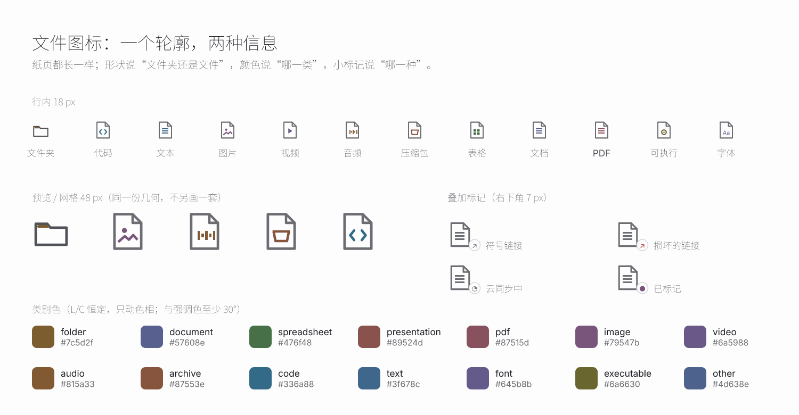

- **轮廓说形状**：文件夹是带页签的轮廓；文件是右上折角的纸。所有文件共用同一张纸，不按类型换轮廓——否则一屏会出现十几种形状，扫读反而变慢。
- **颜色说类别**：族色只出现在两处——纸内的 1.3 px 小标记（代码 `<>`、图片、播放三角、波形、方盒、表格格、齿轮、`Aa`），以及 20 dp 以上时纸面底部 2 dp 色条。
- **尺寸**：行内 18 dp、网格 48 dp、检查器 64–96 dp、预览井 128 dp，共用同一份几何按比例绘制。20 dp 以下省略纸内标记，只保留轮廓与底部色条。
- **文件夹**：轮廓 + 顶部 2 dp `folder` 色带；已知目录（下载、文稿、图片、音乐、视频、桌面、主目录）在 24 dp 以上时纸内画一个小符号（与侧栏同源）。不使用三家的黄/蓝文件夹色。
- **状态标记**（右下角 7 dp）：符号链接 `↗`、损坏链接 `↗`（`danger`）、云同步中、`locked`、已标记（6 dp 实心点，用标签色）。
- **缩略图优先**：`thumbnailSource` 非空的图片/视频在网格与检查器里显示缩略图（2 dp 圆角 + `line` 描边），列表行内默认仍用字形（18 dp 的缩略图没有信息量）。

### 6.4 几何

#### 6.4.1 间距与尺寸

- 间距：4 / 8 / 12 / 16 / 24 / 32。2 dp 只用于光学修正，不作为布局间距。
- 行高：28 / 32 / 40（紧凑 / 默认 / 宽松），标题行 28 / 32 / 36 与行高成对。默认 32：13 px 正文 + 8 dp 上下内边距；中文在 28 dp 行里偏挤，28 只作紧凑选项。
- 控件高度：20 / 24 / 28 / 32 / 36，与行高共用 4 dp 网格。
- 点击目标 ≥ 24×24 dp；图标按钮命中区 ≥ 28×28 dp，视觉区可以更小。
- 侧栏 240（可拖 180–300）；检查器 300（可拖 260–420）；终端默认 240（可拖 160–480）。

#### 6.4.2 圆角

| 级   | 值  | 用在                                   |
| ---- | --- | -------------------------------------- |
| `xs` | 3   | 标签胶囊、徽标、文件字形纸面           |
| `sm` | 6   | 行选择块、按钮、输入框、菜单项、标签页 |
| `md` | 8   | 菜单、浮层、动作条、预览井             |
| `lg` | 12  | 对话框、命令面板                       |
| 窗口 | 10  | 自绘窗口外框（交系统时由系统决定）     |

**同心圆规则**：内层圆角 = 外层圆角 − 内边距。标签页、菜单项、选择块都要满足。

**选择块合并**：连续选中的行合成一整块，只有首尾行分别有上/下圆角（`Rectangle` 6.7+ 的逐角圆角属性），中间行直角。这是本文少数允许的视觉技巧——它让一次多选读成一个对象，而不是 N 个高亮条。

#### 6.4.3 线与设备像素

- 结构线一律 1 个设备像素（`height: 1 / Screen.devicePixelRatio`），而不是 1 dp。1 dp 在 125% 缩放下是 1.25 设备像素，抗锯齿后是一条灰边而不是一条线。
- Qt 6 默认 `QT_SCALE_FACTOR_ROUNDING_POLICY=PassThrough`，125% / 150% / 175% 下 DPR 就是 1.25 / 1.5 / 1.75。4 dp 网格在这些倍率下都落在整数设备像素上（`4 × 1.25 = 5`），但任何 2 / 6 / 10 / 14 dp 的偏移都会落在半像素上。规则：所有 y 坐标与高度取 4 的倍数；需要细调时用 1 设备像素的线，而不是 0.5 dp 的位移。
- 图标按 `ceil(size × DPR)` 缓存栅格并对齐设备像素网格，避免 18 dp 图标在 125% 下变成 22.5 px 的糊块。

### 6.5 海拔

只有三级，每级只有一种手段：

| 级       | 手段                                                                                             | 用于                          |
| -------- | ------------------------------------------------------------------------------------------------ | ----------------------------- |
| 0 · 面   | 明度差 + `hairline`                                                                              | 面板、侧栏、状态条、检查器    |
| 1 · 浮层 | `raised` 面 + 1 px 描边（亮 `line`，暗 `lineStrong`）+ 阴影（亮 y2/blur12/8%，暗 y2/blur16/45%） | 菜单、命令面板、动作条、Toast |
| 2 · 模态 | 浮层 + `scrim`（亮 10% 墨、暗 45% 黑）                                                           | 对话框、确认、冲突合并        |

> 暗色下 `line` 与 `raised` 同值，描边会消失；所以浮层的 1 px 边在暗色取 `lineStrong`（`#3a3d43`）。这不是两套规则，是同一个“看得见的边”在两套明度里的最小值。

- 面板不带阴影（侧栏、检查器、终端都不带），面板之间用 `hairline`。
- 任何时刻只有一个浮起的东西；打开菜单时先关闭已有浮层。
- 阴影用九宫格贴图（`BorderImage`）而不是 `MultiEffect`：后者是 Qt 文档点名的最贵效果之一，而静态阴影贴图在 DPR 2 下也锐利。

### 6.6 动效

| 动作                  | 时长   | 曲线     | 说明                         |
| --------------------- | ------ | -------- | ---------------------------- |
| 悬停、按下、焦点      | 80 ms  | OutQuad  | 只动颜色/透明度              |
| 选择块变化            | 90 ms  | OutQuad  | 只动不透明度                 |
| 菜单/浮层出现         | 120 ms | OutCubic | 透明度 + 2 dp 上移           |
| 面板展开/收起         | 160 ms | OutCubic | 只动一个维度，或改用 opacity |
| 视图切换（列表↔网格） | 160 ms | OutCubic | 只动 opacity                 |
| 动作条出现            | 120 ms | OutCubic | 与状态条原地交换，高度不变   |

- 全部走 `Theme.motion` 开关（现有 `ExplorerPrefs.reduceMotion`）；关闭时瞬时切换而非变慢。
- 用 `OpacityAnimator` / `NumberAnimation` 的 Animator 变体（渲染线程执行），不用 `Behavior`。
- 禁止：行错峰入场、骨架屏循环、按钮回弹、悬停放大、`width/height` 动画触发布局重算。

### 6.7 被删除的构件

| 构件           | 文件 / token                                                      | 处理                                           |
| -------------- | ----------------------------------------------------------------- | ---------------------------------------------- |
| 纸纹           | `qml/Grain.qml`、`Assets/grain-ink.png`、`Assets/grain-paper.png` | 删除（连贴图）                                 |
| 硬偏移投影     | `qml/HardShadow.qml`、`Theme.shadowOffset`                        | 删除，换九宫格柔和阴影                         |
| 点阵底         | `qml/DotPlate.qml`                                                | 删除                                           |
| 虚线框         | `qml/DashFrame.qml`                                               | 删除，拖放改用实线强调色 1.5 dp                |
| 衬线字体       | `Theme.serifFamily` 及 8 处调用（5 个文件）                       | 删除                                           |
| 零圆角         | `Theme.radiusXs…Lg = 0`                                           | 恢复 3 / 6 / 8 / 12                            |
| 侧栏序号、行号 | `Sidebar.qml`、`FileList.qml` 的 `01/02`                          | 删除                                           |
| 目录大标题带   | `FileList.qml` 的 118 dp 标题带                                   | 删除；目录名在路径条与标签页里，计数在状态条里 |
| 黑纸卡片图标   | `qml/DriftSheet.qml`                                              | 替换为 §6.3 文件字形                           |
| 便利贴首页     | `OverviewView.qml` 的图钉便签                                     | 替换为 §11 的首页                              |

---

## 7. 信息设计与构件

窗口的整体观感：

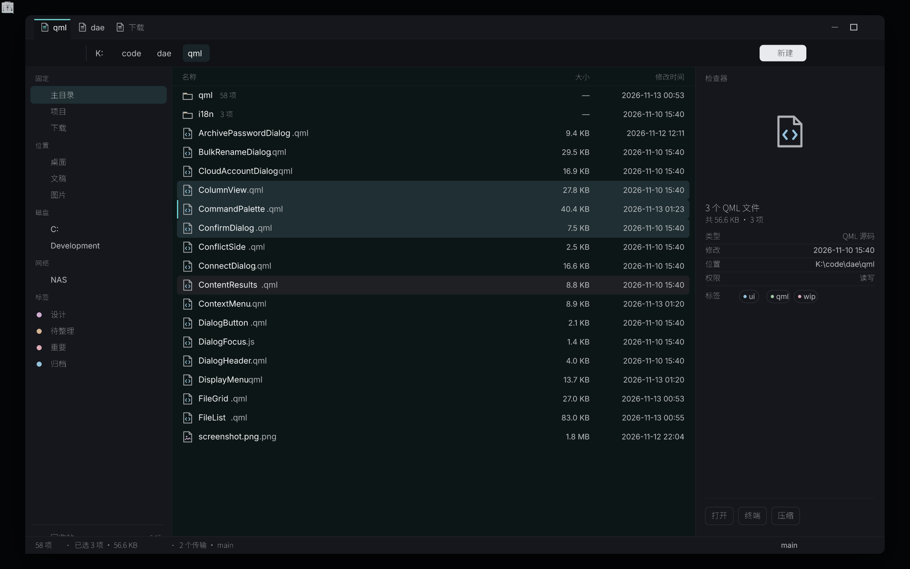

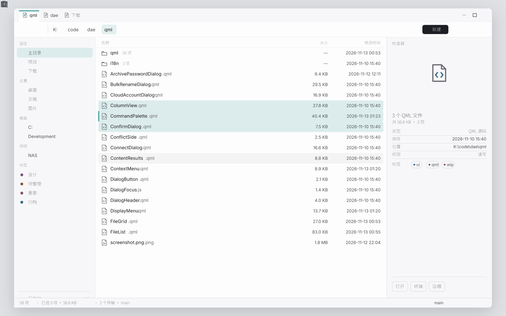

### 7.1 列表行

行是文件管理器里出现次数最多的东西，性能、可读性和"像不像一个文件管理器"都由它决定。

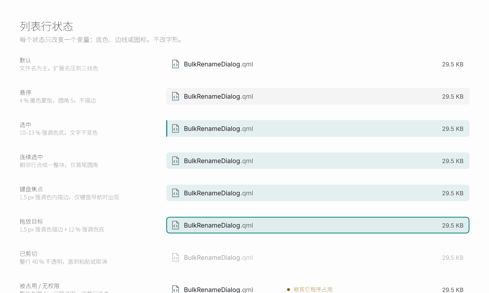

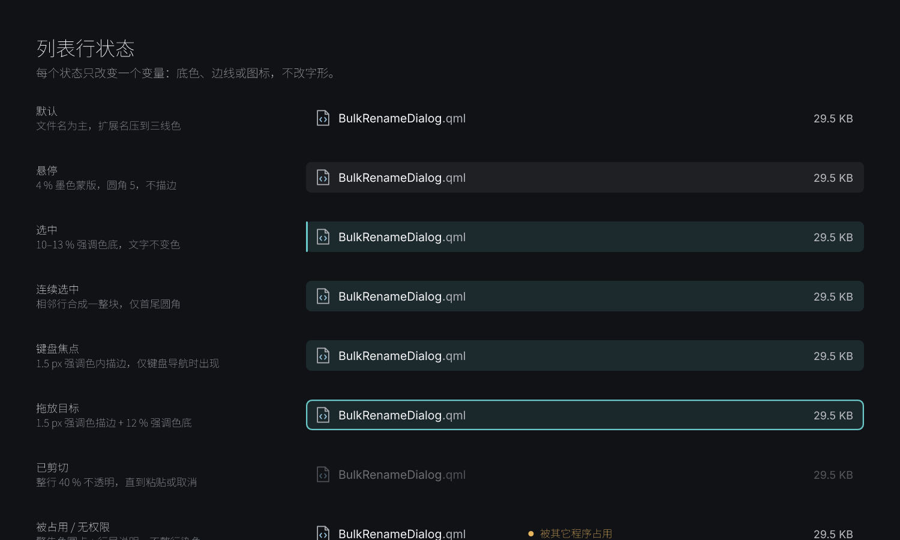

#### 7.1.1 解剖

```
[16] [图标 18] [主干……………][扩展名] [· 标签点 ×3]         [大小][单位]   [类型] [字母]  [修改时间 →]
 ↑       ↑          ↑            ↑                          ↑      ↑        ↑      ↑         ↑
 左内边距  与基线居中   13 px ink   12 px inkTertiary       右对齐 12px   可选列   git 状态  12 px 等宽
```

- 行高默认 32 dp；左内边距 16 dp；图标与名字间距 8 dp；名字与扩展名之间 1 dp。
- 没有行分隔线（可开）；分组头的上边有 1 px `hairline`，行间没有。
- 背景：`canvas`。悬停 4% 墨色蒙版；选中 10%（亮）/ 13%（暗）强调色；焦点行额外 2 dp 强调色左轨，**只在键盘导航时出现**。
- 选中块合并：连续行首尾圆角（`sm`），中间直角（§6.4.2）。

#### 7.1.2 列

| 列       | 宽度           | 对齐 | 可否隐藏         | 说明                                             |
| -------- | -------------- | ---- | ---------------- | ------------------------------------------------ |
| 名称     | flex，最小 260 | 左   | 否               | 图标 + 主干 + 扩展名 + 标签点                    |
| 大小     | 88             | 右   | 是               | 数字等宽；目录默认显示 `—`（§7.1.5）             |
| 类型     | 96–120         | 左   | 是               | 族名（"文档"、"QML 源码"），12 px `inkSecondary` |
| 修改时间 | 150            | 右   | 是               | 12 px 等宽                                       |
| 创建时间 | 150            | 右   | 是（默认隐藏）   | 同一格式                                         |
| 标签     | 120            | 左   | 是（默认隐藏）   | 标签胶囊，最多两个 + "+N"                        |
| 路径     | flex           | 左   | 是（仅搜索结果） | 相对路径，中段省略                               |

窗口宽度不足时按「路径 → 创建时间 → 标签 → 类型 → 修改时间 → 大小」的顺序退让，名称列最后保留（`effectiveColumnWidth()` 现有逻辑沿用，只换顺序）。列宽可拖、双击自适应内容；列可见性与宽度按目录记忆（`ExplorerPrefs` 已支持）。

#### 7.1.3 文件名与扩展名

这是本文与现状差异最大的一处排版决定。

- **主干** `ink`、450 字重；**扩展名** `inkTertiary`、400 字重；两者之间 1 dp。视觉上扩展名退到第二层，扫读时眼睛只读主干，需要时扩展名就在旁边。
- 隐藏扩展名设置（`showExtensions`）关闭时直接不画扩展名，但排序、搜索、重命名仍按真实文件名处理（现有行为）。
- 无扩展名的文件（`Makefile`、`LICENSE`）整串按主干处理。

**省略算法**（替换 `ElideRight`）：

1. 名字总宽 ≤ 可用宽度：整串画出。
2. 超出：保留扩展名，主干从**中段**省略：`前 8 个字符 + "…" + 主干末 6 个字符 + 扩展名`。例：`very-long-component-name.spec.ts` → `very-lon…ec.ts`。
3. 主干本身不足 14 个字符仍超宽：整串中段省略，扩展名随之后移，不再单独保留。
4. 纯中文名字按字符数计（宽度由 `TextMetrics` 实测，不在 QML 里估算）。

第 2 条解决的是文件管理器最常被抱怨的问题：`ArchivePasswordDialog.qml` 与 `ArchivePasswordDialog2.qml` 在右侧省略下无法区分，损失的是最后几个字符，而那通常正是区分位。

#### 7.1.4 数字与时间

- **大小**：数字与单位分开，数字右对齐、单位 `inkTertiary`。二进制单位按设置显示 `KiB` 或 `KB`（`docs/files-parity.md` P1-10 的遗留项）。
- **时间**：同一列里分两档——
  - 今天：`14:32`（等宽，右对齐）；
  - 昨天：`昨天 14:32`；
  - 7 天内：`周三 14:32`；
  - 更早：`2026-11-10`（本地化的年月日格式，按语言切换）。

  悬停显示完整时间戳。这样最近改过的文件一眼就能认出，而旧文件的绝对日期不需要读秒。

- **项数**（目录）：见 §7.1.5。

#### 7.1.5 关于目录项数与大小

`crates/dae-qt/src/model.rs` 的 `summarize()` 已经对整张表做过一次遍历，能免费得到「本目录有几个文件夹/文件/图片」。但**单个子目录里有多少项**需要额外枚举，属于 `docs/decisions/listing-shell-costs.md` 明令禁止的「热路径加逐条系统调用」。

因此：

- 默认**不显示**子目录项数与大小。
- 状态条显示当前目录的总数（`58 项 · 2 个文件夹`）与类型分布，这是免费的。
- 目录行的大小列默认显示 `—`；用户可以右键「计算大小」或按 `Ctrl+Shift+S` 触发按需计算（现有 `directory_size` 能力），结果缓存到该目录的视图记忆里，之后显示。
- 不允许在滚动时对可见行逐个发起枚举：那会在网络卷和 12 万项目录上直接卡死。

#### 7.1.6 类型列与实际类型

类型列写的是**人话**，不是扩展名：`.qml` → `QML 源码`，`.docx` → `Word 文档`，目录 → `文件夹`，无扩展名 → `文件`。映射表放 Rust 侧（与 `category_of()` 同源），QML 只取字符串，便于本地化。

Git 状态作为一个字母（`M`/`A`/`D`/`?`）紧挨类型列右侧，颜色用语义色；不画方框、不占整列。

#### 7.1.7 行状态一览

| 状态            | 表现                                             | 备注                     |
| --------------- | ------------------------------------------------ | ------------------------ |
| 默认            | 面 + 文字                                        | —                        |
| 悬停            | 4% 墨蒙版，圆角 `sm`                             | 不改文字色               |
| 选中            | 10–13% 强调色蒙版，文字 `ink`                    | 连续行合并               |
| 焦点（键盘）    | 选中底 + 2 dp 强调色左轨；未选中时 1.5 dp 内描边 | 鼠标不画                 |
| 拖放目标        | 1.5 dp 强调色描边 + 12% 强调色底                 | 替换虚线框               |
| 已剪切          | 整行 40% 不透明                                  | 粘贴后恢复               |
| 被占用 / 无权限 | 行尾 `warning` 圆点 + 说明文字                   | 不整行染色               |
| 加载中          | 行尾 12 dp 圆形进度（仅目录大小计算时）          | 不闪烁                   |
| 新建 / 刚粘贴   | 高亮一次（160 ms 淡出）后回到默认                | 兼做"东西在哪"的定位提示 |

### 7.2 路径条与搜索

路径条是第二行里唯一的输入控件，三种模式共用一个外框（高 32 dp，`field` 底，`sm` 圆角）：

| 模式   | 触发                | 表现                                                                                                                            |
| ------ | ------------------- | ------------------------------------------------------------------------------------------------------------------------------- |
| 面包屑 | 默认                | 段名 + 分隔符；当前段 `ink`，其余 `inkSecondary`；悬停段给 8% 蒙版；每段右侧的 `⌄` 打开该级**兄弟目录**菜单（点击段本身是跳转） |
| 地址   | 点击空白 / `Ctrl+L` | 整条变成输入框，自动全选，路径补全（现有路径编辑能力），`Esc` 退出                                                              |
| 搜索   | `Ctrl+F`            | 放大镜前置图标，输入即搜；下方出现 30 dp 的过滤条（范围 / 类型 / 时间 / 大小 / 标签），只在搜索态出现                           |

- **段名里不放图标**。每个路径段加一个小图标是三家共有的做法，也是路径条最大的一处视觉噪音；emoji 式的"每段都有图"会让一行出现 5–6 个图形。
- **当前段不加粗**，只换色。加粗会让路径条在跳转时抖动。
- 路径过长时中段折叠成 `…`，保留根与最后两段。
- 搜索态下，路径条左侧出现一个范围胶囊（`此文件夹` / `子文件夹` / `所有位置`），右侧出现结果计数与「保存为搜索」。
- 搜索结果的每一行额外显示相对路径（§7.1.2 的路径列），匹配片段用强调色底 12% 标出（不是改变文字色）。

### 7.3 标签页、侧栏、状态条

#### 7.3.1 标签页

- 第一行高 38 dp，标签本身高 30 dp，`sm` 圆角，底部与第二行相接。
- 激活标签底色等于 `canvas`（与内容面相同），无下划线、无强调色条；文字 `ink` 且 500 字重；非激活透明、`inkSecondary`。
- 标题只显示**目录名**；同名目录（如两个 `src`）在末尾加父目录名：`src · dae`。悬停显示完整路径。
- 关闭按钮只在激活或悬停时出现；中键关闭；拖动排序与撕出保留（现有行为）。
- 标签右侧是 `+`，再往右是标题行空白区（拖动窗口）。文件传输时，目标标签底部显示 2 dp 进度条。
- 标签数量超过宽度时横向滚动，不做多行。

#### 7.3.2 侧栏

- 宽 240 dp，`chrome` 底，与内容面之间一条 `hairline`。
- 分组：**固定**（用户拖入的目的地）→ **位置**（桌面、文稿、下载、图片、音乐、视频）→ **磁盘**（每卷一行，名称右侧显示可用空间）→ **网络** → **云** → **标签**。分组标题 11 px `inkTertiary`，可折叠，折叠状态记忆。
- 行高 28 dp，图标 16 dp `inkTertiary`，文字 13 px `inkSecondary`；当前目的地：8% 强调色底 + `ink` 文字 + 图标转 `accent`。
- 卷行右侧一个 2 dp 容量条（整卷一格，不是 24 格分段——分段量表读起来像电量计，信息量却只有"用了多少"）。
- 底部固定一行「回收站」，右侧项数。
- 拖放：整行 12% 强调色底 + 1.5 dp 强调色描边；悬停 600 ms 自动展开（现有 spring-loaded 行为保留）。
- 侧栏可收起（`Ctrl+B` 或标题行的侧栏按钮）。

#### 7.3.3 状态条与动作条

状态条高 28 dp，`chrome` 底，上边一条 `hairline`。它是**唯一一个会随选择改变的构件**：

| 状态   | 左                               | 中                                                  | 右                                     |
| ------ | -------------------------------- | --------------------------------------------------- | -------------------------------------- |
| 无选择 | `58 项 · 2 个文件夹 · 56 个文件` | 传输胶囊（`2 个传输 · 1.2 MB/s`，点击打开传输面板） | Git 分支、标签、筛选、侧栏、预览、终端 |
| 有选择 | `已选 3 项 · 56.6 KB`            | 同上                                                | 同上                                   |

选中时，**状态条原地换成动作条**（高 36 dp，向上占用 8 dp 的列表空间，不做浮层）：

```
[打开] [剪切] [复制] [粘贴] [重命名] [删除] [移动到…] [压缩] [标签 ⌄] [更多 ⌄]        3 项 · 56.6 KB
```

- 高度变化只发生在第一次选择时（28 → 36），之后保持不变，避免连续点击时列表跳动。
- 动作条只在有选择时存在；无选择时不留空条、不留占位。
- 每个按钮 28 dp 高、`sm` 圆角、无底色，悬停时 `hover` 底。文字按钮而非图标按钮——文件动作的名字比图标更好认（「移动到…」没有好图标）。
- 动手顺序按使用频率：打开、剪切、复制、粘贴、重命名、删除、移动到、压缩、标签、更多。
- 「更多」里放低频项：在终端中打开、复制路径、固定到侧栏、属性、共享、Windows 专有项。

### 7.4 分组标题

- 高 28 dp，文字 11 px `inkTertiary` 500 字重，右侧组内项数；上边 1 px `hairline`。
- 只有一个分组时（常见）不显示分组标题——"按名称分组的 2026 年"没有信息量。
- 分组头吸附在列头下方，滚动时替换而不是重叠。

### 7.5 对话框、菜单、Toast

| 构件       | 规格                                                                                                                                           |
| ---------- | ---------------------------------------------------------------------------------------------------------------------------------------------- |
| 菜单       | `raised` 面，`md` 圆角，1 px `line`，阴影；行高 28，左内边距 12，右侧快捷键 11 px `inkTertiary`；分隔线用 1 px `hairline` + 上下各 4 dp 内边距 |
| 右键菜单   | 与上述同款；分组顺序：打开/打开方式 → 剪切/复制/粘贴 → 重命名/移动到 → 删除 → 标签/压缩 → 属性/平台扩展                                        |
| 简单对话框 | 宽 440，`lg` 圆角，标题 15 px `heading`，正文 13，底部按钮高 28 右对齐，主按钮唯一；遮罩 `scrim`                                               |
| 属性对话框 | 宽 600，左右两栏（左：图标预览 + 名称 + 类型；右：键值表），仍是 `lg` 圆角                                                                     |
| 命令面板   | 宽 560，距顶 15%，`lg` 圆角；输入 17 px；结果分组：文件 / 命令 / 位置；每行右侧显示当前绑定键                                                  |
| Toast      | 高 36，`raised` 面 + 阴影，位于内容区底部中央、动作条上方 8 dp；最多堆叠 3 条，4.5 s 自动消失；撤销类保留 8 s                                  |
| 工具提示   | 12 px，`raised` 面，`md` 圆角，延迟 500 ms，只显示文本                                                                                         |

- 所有破坏性确认的主按钮用 `danger` 底 + 动词文案（"移到回收站"），不用「确定」。
- 传输冲突对话框：左旧右新并排，差异区用 `warning` 标记，`全部应用` 是次要按钮 + 复选框（现有行为）。
- 属性、设置、Git、传输这些"面板型"内容一律用整页或侧栏面板，不做大对话框。

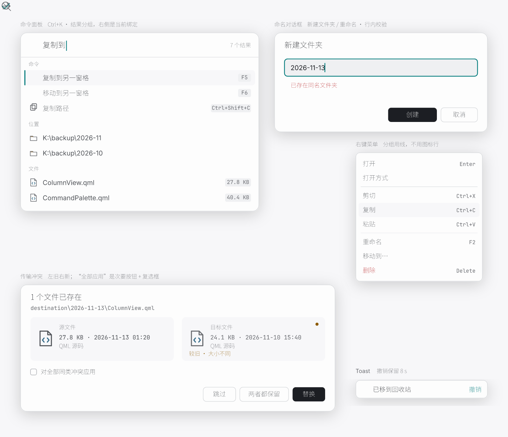

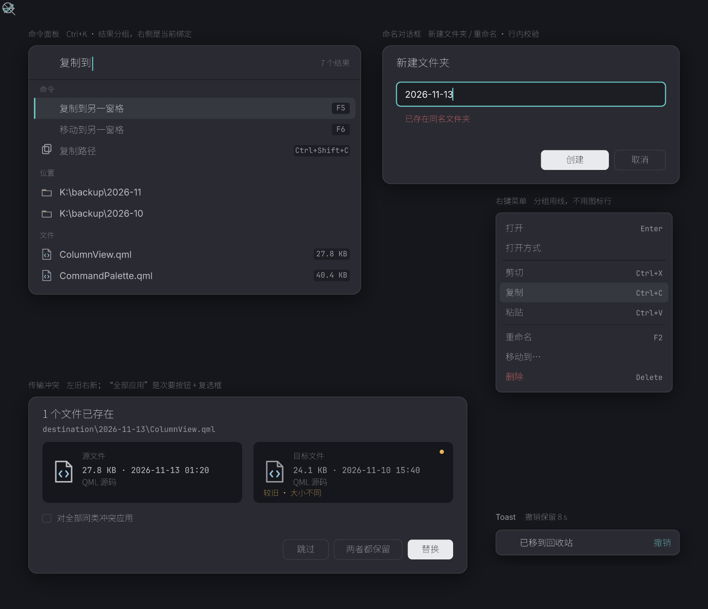

---

## 8. 窗口骨架

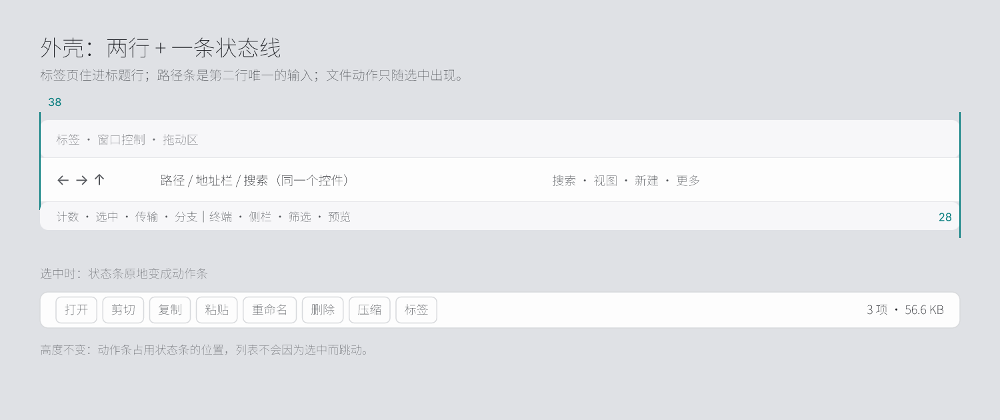

### 8.1 纵向尺寸

| 区              | 高      | 内容                                                             |
| --------------- | ------- | ---------------------------------------------------------------- |
| 标题 + 标签     | 38      | 标签、`+`、拖动区、窗口按钮                                      |
| 导航 + 路径条   | 44      | 后退 / 前进 / 上一级、路径条（三种模式）、搜索、视图、新建、更多 |
| 状态条 / 动作条 | 28 / 36 | 见 §7.3.3                                                        |

默认外壳 **110 dp**（现状 116）。数字本身不是目的，目的是：**第一行文件距窗口顶部 110 + 28（列头）= 138 dp**。在 1280×800 的窗口里，第一行文件落在约 17% 高度处（现状 116 + 118 + 32 = 266 dp，约 33%）。

### 8.2 横向分区

```
┌ 标签 38 ────────────────────────────────────────────── 窗口按钮 ┐
├ 导航 + 路径条 44 ──────────────────────────────────────────────┤
│ 侧栏 240 │              内容区（列表 / 网格 / 分栏）    │ 检查器 300（可关） │
├──────────┴──────────────────────────────────────────────┴────────────────┤
│ 状态条 28（选中时 36 的动作条）                                              │
└──────────────────────────────────────────────────────────────────────────┘
```

- 侧栏折叠后内容区直接从窗口左边开始，不留 1 px 边框。
- 检查器默认关闭；打开时内容区右移 300 dp，列表列宽按 §7.1.2 的顺序退让。
- 终端是内容区下方的内嵌面板（现有布局），不是覆盖层；与检查器可以同时存在。

### 8.3 键盘焦点顺序

标题行 → 导航 → 路径条 → 侧栏 → 列表 → 检查器 → 状态条。`F6` 在侧栏 / 列表 / 检查器 / 终端之间循环（与 IDE 一致，文件管理器里不冲突）。

### 8.4 与现有实现的对应

| 现状                                          | 新结构                       | 改动                                                                                      |
| --------------------------------------------- | ---------------------------- | ----------------------------------------------------------------------------------------- |
| `TitleBar.qml` + `TabStrip.qml` 两个 44 dp 行 | 合并为 38 dp 的 `TopBar.qml` | 需要同步改 `crates/dae-qt/cpp/window.h` 的 `kTitleBarDp` 与 `setCaptionClient` 的左右边界 |
| 导航条 44 dp                                  | 路径条并入同一行             | `PathBreadcrumbs.qml` 重写为 `Locator.qml`（三模式）                                      |
| 状态条 28 dp                                  | 状态条 / 动作条二态          | 新增 `ActionBar.qml`                                                                      |
| 预览面板 300 dp 常驻                          | 检查器默认关闭               | `PreviewPanel.qml` 改为 `Inspector.qml`，默认 `visible: false`                            |

---

## 9. 跨平台一致性的落地清单

### 9.1 不走三家的路

| 三家共有的做法                                            | 本文的替代                            | 为什么                                                  |
| --------------------------------------------------------- | ------------------------------------- | ------------------------------------------------------- |
| 系统强调色驱动选中与焦点                                  | 固定强调色 + 设置里可选跟随系统       | 跟随系统会让三平台界面不同色                            |
| 半透明侧栏 / 材质（Mica、vibrancy、模糊）                 | 不透明面 + 明度差                     | 三平台的材质能力与观感不同                              |
| 黄色（Windows/部分 Linux）或蓝色（macOS/Linux）文件夹图标 | 中性轮廓 + 低浓度族色条               | 两套文件夹色是两家的最大辨识符                          |
| 顶栏一排图标按钮（工具栏）                                | 无工具栏；路径条右侧四个控件 + 动作条 | Explorer / Files / Dolphin 的工具栏是最大的一片"标准件" |
| 右侧常驻详情面板                                          | 默认关闭的检查器                      | Finder / Explorer / Files 都默认常驻                    |
| 选中 = 实心色块                                           | 淡蒙版 + 文字不变                     | 三家都用实心色块；淡蒙版是"安静"的关键                  |
| 分组标题用大写字母 + 字距                                 | 500 字重 + `inkTertiary`，不加字距    | ALL CAPS 小标签是模板化 UI 的标志之一                   |
| 空状态放插画                                              | 一句话 + 两个动作                     | 见 §11.5                                                |

### 9.2 同一套像素

| 项           | 做法                                                                                                                                                                                                                      |
| ------------ | ------------------------------------------------------------------------------------------------------------------------------------------------------------------------------------------------------------------------- |
| 字体         | 自带 Inter / JetBrains Mono（§6.2）                                                                                                                                                                                       |
| 文本渲染方式 | 显式 `QQuickWindow::setTextRenderType(QQuickWindow::NativeRendering)`，让 Windows 走 DirectWrite、Linux 走 FreeType；辅以 `font.hintingPreference: PreferVerticalHinting`（**只在 NativeRendering 下有效**，Qt 文档核实） |
| 文字大小     | 三档 11/12/13 + 标题 15，纯整数像素                                                                                                                                                                                       |
| 线条         | 1 设备像素（§6.4.3）                                                                                                                                                                                                      |
| 图标         | 同一份几何按 DPR 栅格缓存（§12.3）                                                                                                                                                                                        |
| 窗口按钮     | 自绘同款（macOS 交系统）                                                                                                                                                                                                  |
| 滚动条       | 自绘 6 dp，悬停 8 dp，圆角胶囊，无箭头                                                                                                                                                                                    |
| 光标         | 文本光标、I 形光标交给系统（不改造）                                                                                                                                                                                      |

### 9.3 不追求一致的地方

`Ctrl` / `Cmd`；窗口按钮位置（macOS 左、其余右）；右键菜单里的系统扩展项；回收站名称与语义；路径分隔符；字体回退到系统中文字体时的字形（如果选择 §6.2.1 的方案 B）。这些是"平台方言"，强行统一反而会让用户找不到东西。

---

## 10. 交互模型

原则只有一条：**所有已经形成的肌肉记忆全部保留，新增的只是更近的入口。**

### 10.1 选择

| 动作           | 手势 / 键                        | 与现状                                   |
| -------------- | -------------------------------- | ---------------------------------------- |
| 单选           | 单击                             | 不变                                     |
| 追加 / 移除    | `Ctrl` + 单击                    | 不变                                     |
| 区间           | `Shift` + 单击、`Shift` + 方向键 | 不变                                     |
| 框选           | 空白处拖动                       | 不变（`ResizeHandles` 与命中的关系不变） |
| 全选 / 清空    | `Ctrl+A` / `Esc`                 | 不变                                     |
| 前缀跳转       | 直接键入字母                     | 不变（最低成本的高频动作）               |
| 反选、按类型选 | 命令面板                         | 新增（命令已存在则只补入口）             |

多选时**列头保持原位**，动作条只在状态条位置出现；不允许出现"选中后浮出一条遮住最后两行的横条"。

### 10.2 键位（只列新增与需要确认的）

| 动作               | Windows / Linux                    | macOS             | 说明                                         |
| ------------------ | ---------------------------------- | ----------------- | -------------------------------------------- |
| 后退 / 前进        | `Alt+←` / `Alt+→`                  | `Cmd+[` / `Cmd+]` | 不变（栈在 `Tab.qml`）                       |
| 上一级             | `Alt+↑` / `Backspace`              | `Cmd+↑`           | 不变                                         |
| 进入               | `Enter` / 双击                     | 同                | 不变                                         |
| 快速预览           | `Space`                            | 同                | 不变                                         |
| 地址 / 搜索 / 命令 | `Ctrl+L` / `Ctrl+F` / `Ctrl+K`     | `Cmd`             | 不变，但前两者现在作用于同一个控件           |
| 重命名             | `F2`、慢双击                       | `Enter`           | 不变                                         |
| 新建文件夹         | `Ctrl+Shift+N`                     | `Cmd+Shift+N`     | 不变                                         |
| 删除 / 永久删除    | `Delete` / `Shift+Delete`          | `Cmd+Backspace`   | 不变                                         |
| 侧栏               | `Ctrl+B`                           | `Cmd+B`           | **新增**（现有设置项缺快捷键）               |
| 检查器             | `Ctrl+I`                           | `Cmd+I`           | **新增**（预览面板的开关现在只有状态条按钮） |
| 视图切换           | `Ctrl+1/2/3`（列表 / 网格 / 分栏） | `Cmd+1/2/3`       | **新增**                                     |
| 隐藏文件           | `Ctrl+H`                           | `Cmd+Shift+.`     | **新增**（现在只在显示菜单里）               |
| 复制到另一窗格     | `F5`                               | `F5`              | 仅分屏视图；`F6` 循环焦点，`Shift+F6` 反向   |
| 关闭 / 恢复标签    | `Ctrl+W` / `Ctrl+Shift+T`          | `Cmd`             | 不变                                         |

所有新增键位必须同时进命令面板、设置页的可重绑列表和菜单右侧的提示（`Shortcut.js` + Rust `shortcuts.rs` 现有机制）。

### 10.3 拖放

- **拖影**：被拖文件的首个图标 + 数量徽标（`3`），不画虚线框；徽标底色 `ink`、文字 `canvas`。
- **修饰键反馈**：同卷默认移动、跨卷默认复制、`Ctrl` 强制复制、`Shift` 强制移动；拖影下方一行小字显示当前判决（"移动 3 项"）。
- **目标反馈**：可投放的行、侧栏目的地、路径段、标签、标签页都显示 1.5 dp 强调色描边 + 12% 底；不可投放的目标显示禁止光标，不显示描边。
- **Spring-loaded 文件夹**：悬停 600 ms 打开（现有行为保留），打开后拖影保持。
- **拖到路径段** = 移到该级；**拖到标签** = 移到该标签所在目录；**拖到标签页某标签** = 同上。三者都要在文档与命令面板里可发现。
- **从外部拖入**：整窗接收，进入时显示当前目标的面反馈；多个来源时显示数量。
- **拖出到系统**：沿用现有 `dae-qt` 的 drag 实现。

### 10.4 重命名

- `F2` / 慢双击 / 右键进入行内编辑；编辑框默认只选中**主干**，不含扩展名。
- 编辑框是行内的 `field` 底 + 1.5 dp 强调色描边，不弹对话框。
- 与现有文件同名时，确认前就在行下方显示 12 px `danger` 提示（"已存在同名文件"），不等到回车后报错。
- 批量重命名沿用现有正则对话框，但结果预览改为「旧名 → 新名」两列等宽，冲突行用 `warning` 标出。

### 10.5 剪贴板与撤销

- 剪切后，源行立即降至 40% 不透明，直到粘贴或 `Esc`。
- `Ctrl+V` 粘贴的目标是**当前目录**；若当前有选中目录且不是多选，则粘贴进该目录（现有行为，保持）。
- 撤销/重做覆盖 重命名、移动、复制、删除、新建（现有 `fs::undo` 已具备）；成功 Toast 上给「撤销」，保留 8 s。
- 状态条左侧在剪贴板非空时显示 `剪贴板 2 项 · 复制`，点击可清空。

### 10.6 文件操作与进度

- **< 400 ms**：无进度，只给一次行高亮（§7.1.7 的"新建/刚粘贴"）与 Toast。
- **> 400 ms**：状态条传输胶囊出现，带 2 dp 进度环；点击打开传输面板（沿用 `TransferQueue.qml` 的数据）。
- **目标标签**在传输进行时底部显示 2 dp 进度条；标签页是任务的天然归属。
- **冲突**：对话框（§7.5）；「跳过全部」「覆盖全部」「保留两者」是三选项，不是二级菜单。
- **权限失败**：明确区分"需要更多权限"（提供一次操作的提权重试，现有 `elevated-job`）与"文件被占用"（点名占用程序，现有 Restart Manager / `/proc` / `lsof` 能力）。
- 进度条、速率、剩余时间全部等宽数字；暂停 / 取消 / 限速按钮常驻在传输行右侧，不藏在菜单里。

### 10.7 搜索

- 范围三选：此文件夹、子文件夹、所有位置；"所有位置"在索引不可用时明确标注"逐个遍历，可能较慢"。
- 过滤条件与保存搜索沿用现有能力；保存的搜索出现在侧栏「标签」下方的「搜索」分组里。
- 结果按路径分组（分组标题 = 相对路径），每条结果显示所在目录。

### 10.8 错误与空状态

| 场景       | 表现                                                                                                                    |
| ---------- | ----------------------------------------------------------------------------------------------------------------------- |
| 空目录     | 一行 13 px `inkSecondary`：`这个文件夹是空的`；下方两个文字动作：`新建文件夹`、`粘贴`（剪贴板为空时隐藏）               |
| 无搜索结果 | `没有匹配 "xxx" 的文件` + `在此文件夹中搜索内容` + `清除筛选`                                                           |
| 加载中     | 列头下方一条 2 dp 的不确定进度线（只在 > 300 ms 时出现）；已有内容时保持可见，不闪白                                    |
| 权限拒绝   | 目录区中央一段说明（12–13 px，左对齐，不居中大字）：`无法读取这个文件夹。` + 原因 + `以管理员身份重试` / `复制错误详情` |
| 网络断开   | 同上，外加 `重新连接`；不弹模态                                                                                         |
| 目标不存在 | `这个位置已不存在。` + `返回到 <上一级>`                                                                                |

**空状态没有插画、没有居中大标题、没有装饰性图形**。一段说明加一两个动作，左对齐在内容区左上角（不是垂直居中——垂直居中会把空白放大）。

---

## 11. 其它页面

### 11.1 首页（概览）

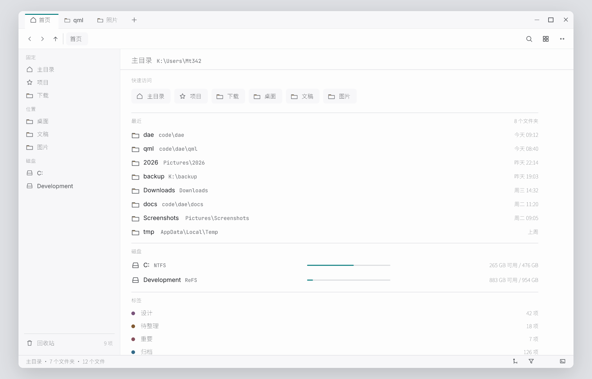

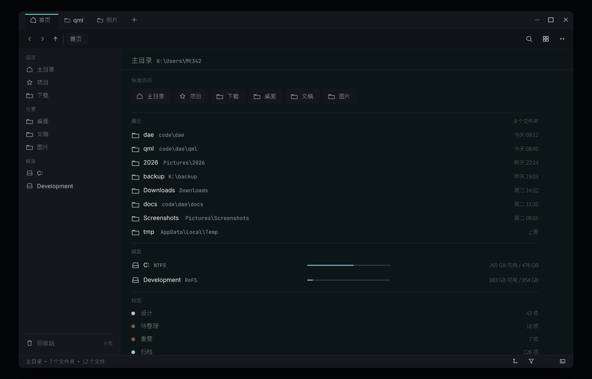

现状是软木板 + 图钉 + 倾斜便签（`OverviewView.qml`），与"安静的工具"直接冲突。改为**一个安静的分组列表**，与文件列表共用行构件：

```
快速访问   [主目录] [项目] [下载] [桌面]          （6 个最多，图标 + 名称，一行）
最近      最近 8 个文件夹，单行等宽名称 + 相对路径 + 时间
磁盘      每一卷一行：名称、文件系统、容量条、可用/总量
标签      每个标签一行：圆点、名称、项数
```

- 无墙纸、无图钉、无倾斜、无阴影。
- 最近项来自现有 `OverviewModel`；磁盘容量来自 `sidebar_model`。
- 首页不占一个标签页位置也可以：`Ctrl+T` 打开的就是"新标签 = 首页"，一旦导航就变成普通标签。

### 11.2 网格

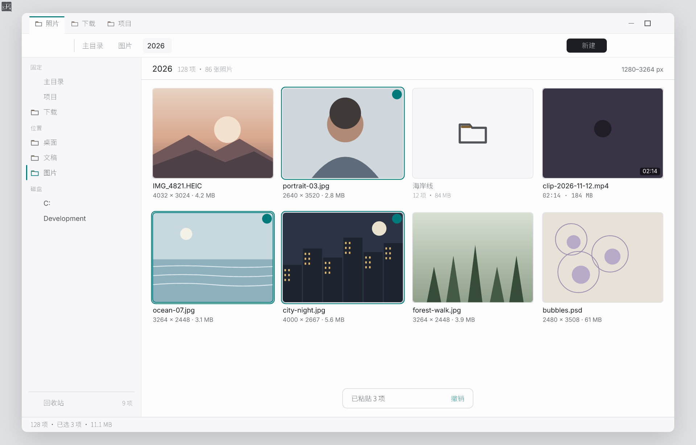

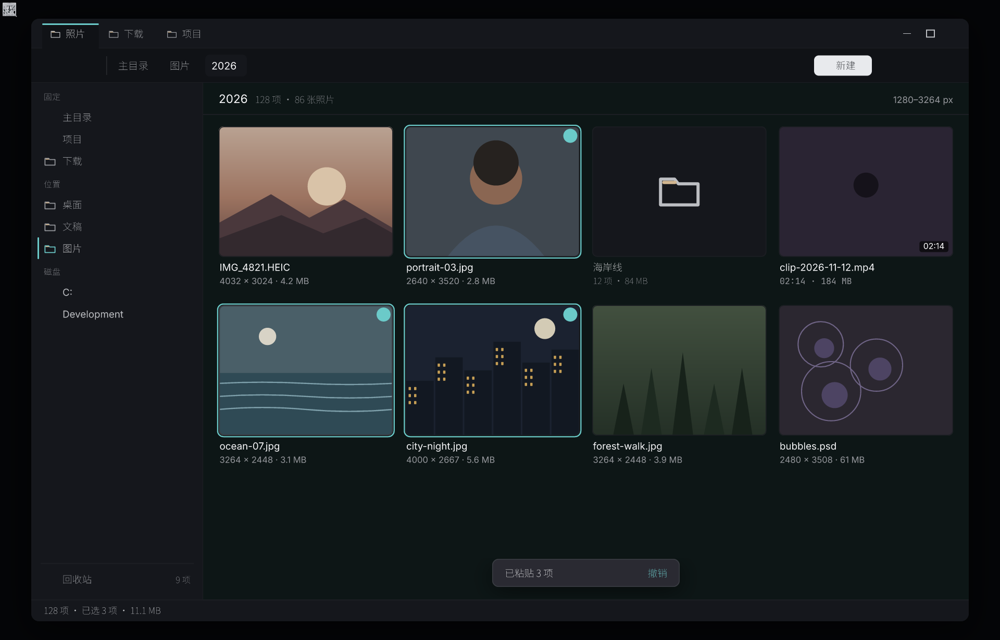

- 默认列数由宽度决定，最小单元 104 dp，间距 12 dp，缩略图 3:4 或 1:1（按设置），名称两行，第二行是大小/时间（12 px `inkTertiary`）。
- 选中 = 一轮 `sm` 圆角 + 1.5 dp 强调色描边 + 右上角 16 dp 圆形勾选点；不整格染色。
- 文件夹不填充黄色块，用 §6.3 的轮廓 + 色带。
- 缩略图异步加载，占位是 `inset` 底 + 族色小标记，不是骨架屏动画。
- 图集（justified gallery）作为可选视图，属于 §14 末尾「待定」的视图优先级议题，不在本轮必需项里。

### 11.3 分栏（Miller columns）

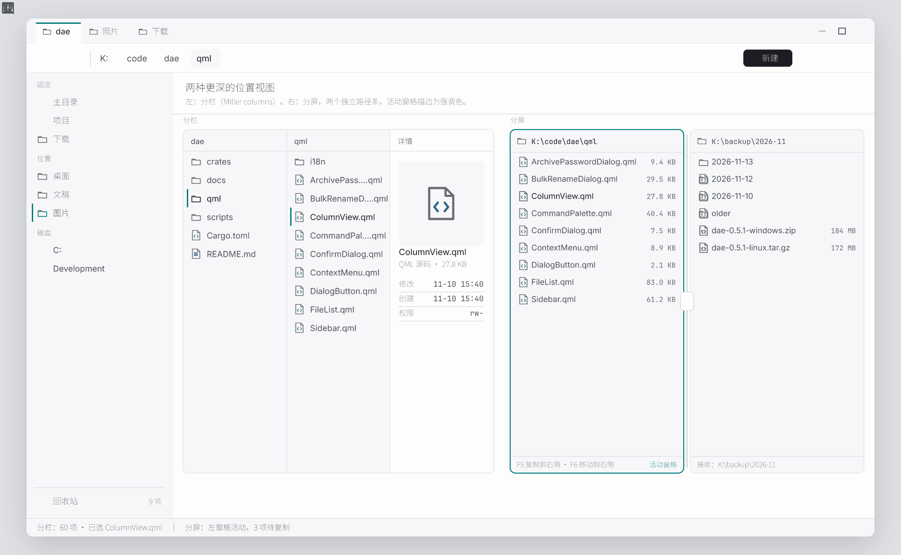

- 列宽 260，列间 1 px `hairline`，列头 28 dp 吸附。
- 选中列之外的列压到 70% 不透明度（只压内容，不压文字）。
- `←` / `→` 跨列移动焦点并展开下一列；`Enter` 进入。
- 分栏视图里不画选中行左轨（列宽窄，左轨会挤字），用蒙版 + 文字色即可。

### 11.4 分屏

- `Ctrl+\` 分屏，两栏各自有独立的路径条与标签页；活动窗格的路径条描边为 `accent`，非活动为 `line`。
- `F5` / `F6`：复制到另一窗格所选目录 / 移动。
- 两栏之间 1 dp `hairline`，可拖 200–800；双击回到 50%。

### 11.5 检查器

- 默认关闭，`Ctrl+I` 或状态条按钮打开；宽度 300（可拖 260–420）。
- 无选择：显示**当前目录**的信息（名称、路径、项数与类型分布、总大小（按需）、Git 状态）——比"未选择文件"有信息量。
- 单选：名称 + 类型 + 大小 + 时间，预览井（图片/文本/视频首帧），标签编辑，权限摘要，「全部属性」入口。
- 多选：`3 项 · 56.6 KB` + 类型分布 + 可以同时编辑的标签。
- 检查器内的键值对：键 12 px `inkTertiary` 左对齐，值 12 px `inkSecondary` 右对齐，行间 1 px `hairline`（虚线改为实线）。
- 检查器不带阴影、不带圆角卡片；它是一列面，不是一个卡片。

### 11.6 终端

- 内容区底部内嵌，默认 240 dp，可拖到 480。
- 头高 28 dp：会话名、工作目录、「跟随当前目录」开关、清屏、关闭。
- 配色跟随主题（现有 `terminalCanvas/Header/Ink` 保留，值改为新 token）。
- 终端字体 = `Theme.monoFamily`；中文按 §6.2.1 处理。

### 11.7 回收站、空间、Git、设置

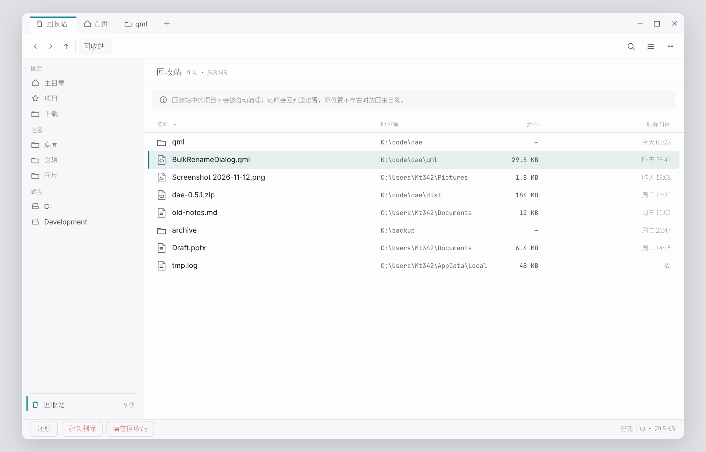

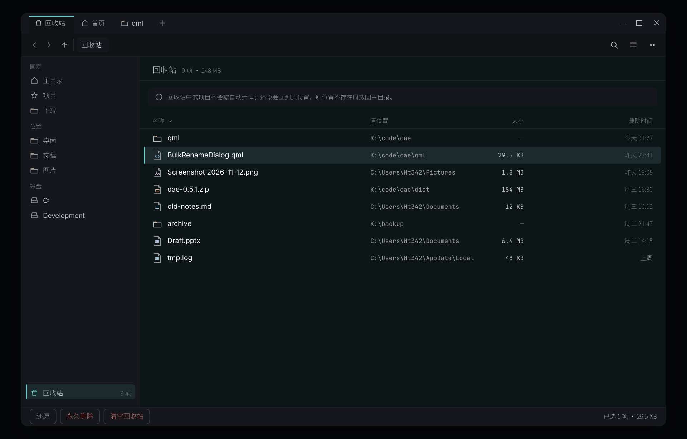

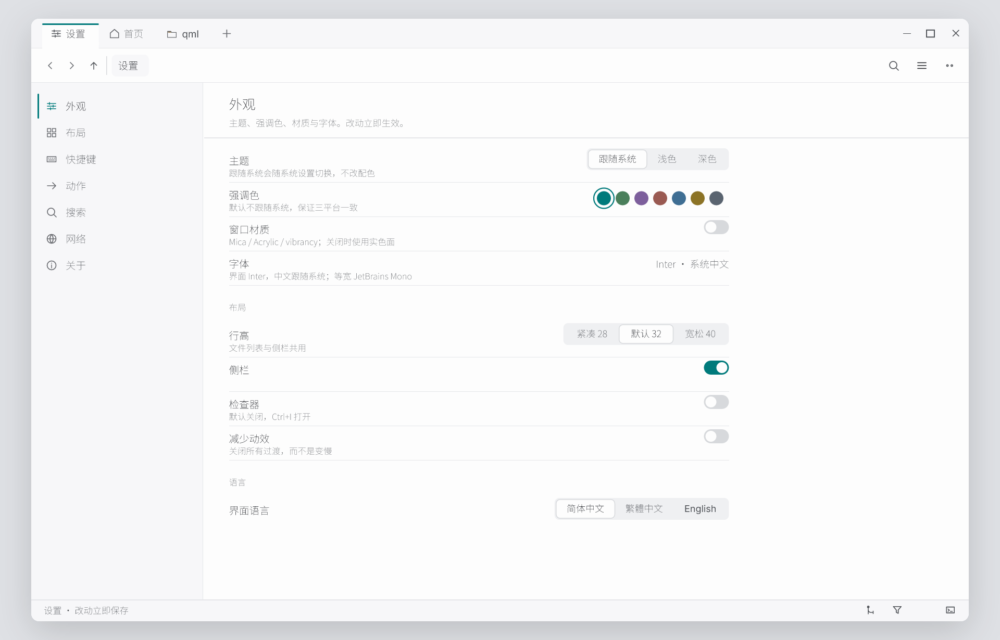

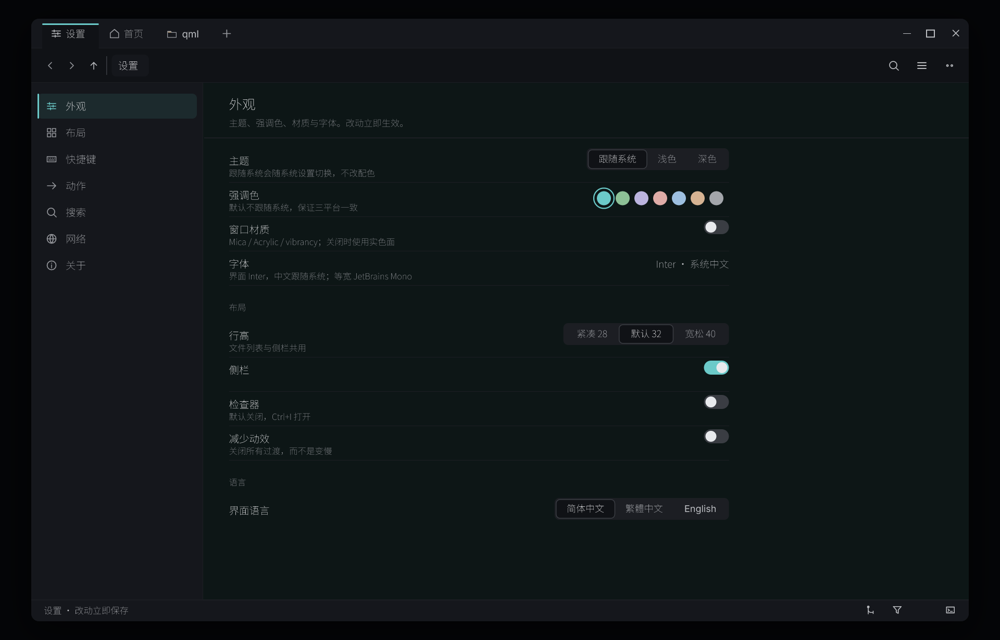

- 回收站：与列表同一套行；顶部一条信息条（`回收站中的项目不会被自动清理`），列表多一列「原位置」；动作条固定为「还原」「永久删除」「清空回收站」，不随选择出现消失。
- 空间（Spaces）：沿用概念，但条目在侧栏是普通目的地行，不再有倾斜纸卡。
- Git 面板：检查器的一个页签，或状态条 Git 分支胶囊弹出的浮层；不单独占一个面板。
- 设置：整页（左分类 + 右内容），行高 40，键值对布局；颜色、字体、密度、材质全部在这里，且每项旁边给"恢复默认"。

---

## 12. 技术方案

### 12.1 前端骨架

- `Theme.qml` 继续做唯一 token 源：两套静态色表（亮/暗）+ `dark` 开关，颜色值直接写字面量（不走 `Qt.lighter()` 之类的运行时计算），保证取色可核对。
- 新增一组基础构件，所有页面只允许使用它们：`Surface`（面 + 可选描边）、`Row`（列表行容器）、`Icon`（Solar/File 两种来源）、`Button`、`TextField`、`Menu`、`Dialog`、`Toast`、`ActionBar`、`Splitter`。
- 现有 56 个 QML 文件的处置见附录 B（附录 B 只列改动过的文件）：**改的**（`Theme`、`ShellWindow`、`FileList`、`FileGrid`、`ColumnView`、`Sidebar`、`PathBreadcrumbs`、`PreviewPanel`、`StatusCenter`、`TransferQueue`、菜单与对话框）、**删的**（`Grain`、`HardShadow`、`DotPlate`、`DashFrame`、`DriftSheet`）、**保留的**（`Tab`、`SidebarTree`、`SettingsPanel`、`TerminalPanel`、`GitPanel`、`Shortcuts`）。

### 12.2 选择块的实现

连续选中合并成一整块，需要逐角圆角（Qt 6.7+ 的 `topLeftRadius` 等，已核实）。两行之间的接缝用"中间行直角"消除，不需要额外的绘制节点。

滚动时保持选择块视觉稳定：选择状态来自模型角色（现有 `selected` 角色 + `dataChanged` 只发变化行），delegate 只读 `selected` 与相邻两行的 `selected`（`previousSelected` / `nextSelected` 两个角色由 Rust 侧在排序/选择变化时一并更新），避免 delegate 在绑定时去访问列表。

### 12.3 图标管线

现状每个图标一个 `Canvas`（`Glyph.qml`、`DriftSheet.qml`），意味着屏幕上每个文件都有一张独立的栅格缓冲区，且不同尺寸下形状会略微变化。

**方案（按优先级）：**

1. **保留 Solar 的路径数据，替换渲染方式。** 三条可选路线，按落地成本排序：
   - **栅格缓存**（推荐先做）：用 Rust 侧的 `resvg`/`tiny-skia` 或 Qt 的 `QSvgRenderer` 把每个 (kind, size, DPR, 主题色) 渲染一次，缓存在 `QQuickImageProvider` 里。行内图标变成普通 `Image`，代价是一张纹理，绘制路径与今天完全一致。
   - **`Shape` + `PathSvg` + `CurveRenderer`**（6.6+）：一个 `Shape` 放多个 `ShapePath`，可染色、可缩放，但需要确认 `PathSvg` 对 `A` 圆弧命令的支持（官方文档未逐命令声明，**需实测**）与自交路径的填充规则。
   - **`VectorImage`**（6.8+）：适合尺寸会变的少量图标；但它没有官方染色 API，官方文档也建议固定尺寸的图标用栅格化，因此不适合作为文件图标的默认路径。
2. **文件字形**用同一份 20 网格几何按尺寸绘制，栅格缓存键为 `(族, 尺寸, DPR, 主题)`。
3. **禁止**在 delegate 里创建 `Canvas`。

### 12.4 文字

- `QQuickWindow::setTextRenderType(NativeRendering)`，配合 `font.hintingPreference: PreferVerticalHinting`。理由：QtRendering 是距离场字形，小字号在 100% 缩放下发虚；NativeRendering 在 Windows 走 DirectWrite、Linux 走 FreeType，最接近用户在编辑器与系统里看到的字形。**注意**：NativeRendering 不适合同一文字做缩放动画（会像素化），本文的动效只动透明度，不违反这条。
- 12–13 px 中文在两套 hinting 下的清晰度必须在 **100% / 125% / 150%** 三个缩放上实机比对（§13.4 的验收项），而不是只看 200%。
- 字体通过 `QFontDatabase::addApplicationFont` 从 qrc 加载；回退链见 §6.2.1。

### 12.5 布局与设备像素

- `Screen.devicePixelRatio` 在 125%/150%/175% 下分别是 1.25/1.5/1.75（Qt 6 默认 PassThrough）。所有 4 dp 的倍数在这些倍率下都是整数设备像素；所有 1 dp 的线改为 `1 / DPR` 并放在 4 的倍数坐标上。
- `Rectangle.border.pixelAligned` 默认为 `true`（6.5+，已核实），但只保证边框宽度取整，不保证位置；位置同样要对齐。
- 不推荐 `QT_SCALE_FACTOR_ROUNDING_POLICY=Round` 回避这个问题：它会让 125% 的用户看到 100% 或 200% 的界面，损失可用空间。

### 12.6 RHI / GPU：用在哪，不用在哪

**判据**：只有「成本被实测证明」且「视觉结果能被用户直接感知」的地方才引入 GPU 路径。GPU 不是审美手段。

| 候选                                  | 判据                                                                                                                                                          | 结论                                              |
| ------------------------------------- | ------------------------------------------------------------------------------------------------------------------------------------------------------------- | ------------------------------------------------- |
| 高密度网格（缩略图图集 + 实例化绘制） | 一个 1 万张图片的目录，QML delegate 的数量与内存会成为瓶颈；图集 + 一个节点可以把绘制调用压到个位数                                                           | **值得做**（P4 之后），回退到普通 `GridView`      |
| 列表的选择块与行底统一绘制            | 12 万行滚动时 delegate 的背景矩形是最大的一类节点；一个自定义 `QSGGeometryNode` 画可见区的行底/选择块/分隔线，文字仍用 QML `Text`（保住可访问性与行内重命名） | **值得做**（P6 性能阶段），先用现有 delegate 撑住 |
| 柔和阴影                              | 菜单/对话框/动作条各 1 个，数量少；`BorderImage` 九宫格已经足够                                                                                               | **不需要** GPU                                    |
| 终端网格（字形图集）                  | 现有 `TerminalItem` 是 `QQuickPaintedItem`，每帧在 CPU 上 `QPainter` 绘制并上传纹理；高频输出时会占满 GUI 线程                                                | **值得做**（独立议题），改场景图节点 + 字形图集   |
| 1 px 线与圆角                         | Qt 6 的 `Rectangle` 已能按设备像素对齐，逐角圆角已内置                                                                                                        | **不需要**                                        |
| 玻璃/模糊背景                         | 三平台能力不同，且与"统一观感"冲突                                                                                                                            | **不做**                                          |
| 装饰性着色器（噪点、渐变、光晕）      | 与 §6.1.8 的删除清单冲突                                                                                                                                      | **不做**                                          |

**前置条件**：自定义着色器（`ShaderEffect` / `QSGMaterial` / `QQuickRhiItem`）需要 `.qsb`，由 **Qt Shader Tools** 模块的 `qsb` 生成。当前本机 Qt 6.12 安装**没有**该模块（`K:/Qt/6.12.0/msvc2022_64` 下无 `qsb`），CI 的 `install-qt-action` 也只装了 `qtmultimedia`。要走进 GPU 路线，先补两处：

- 本机：Qt Maintenance Tool → Additional Libraries → Qt Shader Tools；
- CI：`modules: qtmultimedia qtshadertools`（`qt-check.yml`、`release.yml`、`perf-check.yml` 三处）。

另外两条现实约束：

- `QQuickRhiItem` 在 Qt 6.12 仍是 Technology Preview（官方文档核实），接口不保证兼容；
- 只想画几何、不上自定义着色器时，用 `QQuickItem::updatePaintNode` + `QSGGeometryNode` + `QSGFlatColorMaterial` / `QSGVertexColorMaterial`，**不需要 qsb**。本文的列表与网格候选都优先走这条。

### 12.7 性能预算

沿用 `docs/decisions/listing-shell-costs.md` 的口径，新增三条与本文直接相关的：

| 指标                    | 预算                                                     | 测量方式                          |
| ----------------------- | -------------------------------------------------------- | --------------------------------- |
| 12 万项目录的滚动帧工作 | p95 ≤ 6 ms（现状 5.68 ms）                               | 现有 bench 与 `QSG_RENDER_TIMING` |
| 视图切换（列表↔网格）   | 首帧 ≤ 120 ms，动画不丢帧                                | 手动 + 计时日志                   |
| 图标首次渲染            | 每个 (kind, size, DPR) 只栅格一次；冷启动多做一次 ≤ 8 ms | 新增计数器                        |
| 110 dp 外壳             | 任何页面不因标题带、分组头叠加而超过                     | 截图量尺                          |

---

## 13. 迁移与验收

### 13.0 准入条件（每个阶段都要满足）

1. 亮/暗两套下，正文对背景 ≥ 4.5:1，主文字 ≥ 7:1（脚本复核）。
2. `qmllint` 无新增告警；`node scripts/a11y-audit.mjs` 无新增缺口。
3. 100% / 125% / 150% 三个缩放各截一张图，1 px 线不断续、图标不糊。
4. 没有一处新增的渐变、玻璃、纸纹、硬投影、插画、emoji 图标。

### 13.1 阶段

| 阶段                  | 内容                                                                                 | 完成判据                                                             |
| --------------------- | ------------------------------------------------------------------------------------ | -------------------------------------------------------------------- |
| **P0 设计系统**       | `Theme.qml` 换 token；新增基础构件；删除 §6.7 的构件                                 | 全仓库只剩一套颜色来源；`Grain/HardShadow/DotPlate/DashFrame` 无引用 |
| **P1 外壳**           | `TopBar`（标签 + 窗口按钮）、`Locator`（三模式）、状态条/动作条；`window.h` 的标题高 | 外壳 110 dp；第一行文件距顶 ≤ 138 dp；拖动/双击/Snap 全部正常        |
| **P2 列表**           | 行解剖、文件名分层与中段省略、等宽数字、相对时间、图标管线、行状态、焦点             | 1280×800 下 ≥ 20 行；长名字保留扩展名；12 万行滚动不回归             |
| **P3 检查器与动作条** | 检查器默认关、三态内容；动作条接入真实命令                                           | 选中后动作可用；无选择时无空面板、无空条                             |
| **P4 浮层**           | 菜单、右键菜单、对话框、命令面板、Toast、工具提示                                    | 只有一级阴影；菜单不超出窗口；Esc 全部可关                           |
| **P5 视图与页面**     | 网格、分栏、分屏、首页、回收站、设置                                                 | 同一行构件在所有列表类页面复用                                       |
| **P6 平台与性能**     | 字体自带、文本渲染方式、设备像素审计、可选 GPU 路径                                  | §9.2 的清单逐项通过；§12.7 的预算达标                                |

每个阶段都可以单独发布；P0–P2 完成时界面已经是另一个东西。

### 13.2 与现有文档的关系

- `docs/ui-ux-2026.md`、`docs/ui-instrument-migration.md`、`docs/ui-drift-migration.md` 转为**历史记录**，不再作为执行依据；其中仍然有效的判断（116 px 外壳的来历、选择与焦点的输入来源过滤、`reduceMotion` 的做法、图标数据来源的决定）已在本文继承。
- `docs/decisions/glyph-source-solar.md` 的**数据来源**决定保留，**渲染方式**（每图标一个 Canvas）被 §12.3 取代，需要补一条新的决策记录。
- `docs/files-parity.md` 的功能清单不受影响；本文只改呈现。

### 13.3 回归面（不能因为改皮丢掉的行为）

标签页新建/关闭/拖动/撕出/恢复；每标签独立历史；`Ctrl+L` 路径编辑；列表/网格/分栏/分屏四种视图；排序升降与分组；选择、连选、框选、前缀跳转；搜索（名称/内容/大小写/类型）与保存搜索；重命名冲突提示；新建/复制/剪切/粘贴/撤销；回收站移入/还原/永久删除/清空；拖到侧栏与文件夹；预览文本/图片/文件夹/回收站；终端输入；传输队列与暂停/取消/限速；Git 分支；快捷键重绑后菜单与面板显示新键；窗口拖动/缩放/最小化/最大化/关闭；标签点击不触发窗口拖动；减少动效开关；中英文界面无截断。

### 13.4 必须在真机上量、不能靠推的四件事

1. **中文字体**：Inter + 系统中文（已定方案 B）在 Windows 100% / 125%、Linux 150% 下的基线、行高、字面大小。这组数据同时是 §14 决策 2 的复核证据——若出现可见差异，重新评估随包 Noto Sans SC。
2. **文本渲染方式**：`NativeRendering` + `PreferVerticalHinting` 与默认 `QtRendering` 在 12–13 px 中文上的清晰度对比。
3. **设备像素**：125% / 150% / 175% 三个缩放下的 1 px 线、18 dp 图标、选择块接缝。
4. **`PathSvg` 圆弧**：Solar 的路径数据大量使用 `A` 命令，走 `Shape` 路线前必须先证明它被支持（图标的渲染方式本身尚未定，见 §12.3 的三条路线）。

### 13.5 复核工具

配 `docs/ui-redesign/check-contrast.mjs`（Node 直接运行，无依赖）：打印中性色阶、两套主题的角色、每对文字/面的 WCAG 对比度、强调色与类型色的实测值与色相距离。任何改色的提交都要先跑它，并附输出。

---

## 14. 已定的决策

> 2026-11-14 评审确定。本节是决策记录，落地时以它为准；要改，按 `docs/decisions/` 的格式另立文档。

| #   | 决策                 | 结论                                                                                                                 | 影响                                                                                                                   |
| --- | -------------------- | -------------------------------------------------------------------------------------------------------------------- | ---------------------------------------------------------------------------------------------------------------------- |
| 1   | 系统强调色与系统材质 | **放弃默认跟随**：默认使用本文的固定强调色与不透明面；设置里保留「跟随系统强调色」「窗口材质」两项，关闭状态下为实色 | §5.2、§6.1.4 成立；`Theme.backdropTint()` 只在用户显式开启材质时生效；不再读 `Workspace.accent` 作为默认 `interactive` |
| 2   | 中文字体             | **先跟随系统**（§6.2.1 方案 B）：拉丁与数字用自带的 Inter，汉字回退到微软雅黑 / PingFang / Noto Sans CJK             | §6.2.1 的 A 方案（随包 Noto Sans SC 子集）暂不实施，保留为后续可选项，门槛见下                                         |
| 3   | 默认行高             | **32 dp**（紧凑 28 / 宽松 40 保留）                                                                                  | §6.4.1、§7.1.1；表格标题行 32                                                                                          |
| 4   | 检查器默认状态       | **默认关闭**，`Ctrl+I` 或状态条按钮打开；状态按窗口记忆                                                              | §8.2、§11.5；`PreviewPanel.qml` 改为 `Inspector.qml` 且 `visible: false`                                               |

决策 2 的复核门槛：只有满足下面两条之一，才把中文字体改成随包（方案 A）——

- Linux 与 Windows 同窗口中英混排的对比截图出现**字面大小或基线**的可见差异，且已经影响到行高对齐；
- 用户反馈里出现「中文显示与英文不协调」类的具体问题。

没有这两个证据就不做方案 A：多 4–6 MB 的安装包与一次子集生成流程，不值得只为理论上的统一。

另外三件**不需要现在决定、但影响工作量**的事：

- 视图的优先级：列表与网格是主体，分栏与分屏要不要在 P5 一并做成「一等视图」（现在它们是次级入口）。
- 是否接受两个**新增视图**：图集（照片目录）与磁盘占用图（GPU 路径的第一个真实用途）。这两个不是本次重设计的必需项。
- 是否接受**删除** drift 的全部构件（§6.7）。如果希望保留一种「纸张」主题作为可选皮肤，需要额外维护两套 token 与两套图标渲染。

---

## 附录 A · token 迁移表

| 现有 `Theme.qml`             | 新值（亮 / 暗）                                  | 说明                        |
| ---------------------------- | ------------------------------------------------ | --------------------------- |
| `canvas`                     | `#fdfdfd` / `#101216`                            | 内容面                      |
| `canvasAlt`                  | 删除                                             | 用 `inset` 与 `raised` 取代 |
| `chrome`                     | `#f7f7f9` / `#15171c`                            | 框架                        |
| `raised`                     | `#fdfdfd` / `#292b30`                            | 浮层                        |
| `field`                      | `#eff0f2` / `#1c1e23`                            | 输入                        |
| `ink`                        | `#1c1e23` / `#f7f7f9`                            | 主文字                      |
| `inkMuted`                   | → `inkSecondary` `#505358` / `#bcbec2`           | 改名                        |
| `inkFaint`                   | → `inkTertiary` `#6b6d72` / `#96989d`            | 改名                        |
| `hairline`                   | `#e5e6e9` / `#1c1e23`                            | 线                          |
| `hairlineStrong`             | → `line` `#d7d9dc` / `#292b30`                   | 改名                        |
| `rowRule`                    | 删除（可选设置项）                               | 行间不画线                  |
| `hover`                      | 4% 墨蒙版                                        | 值不变，用法收紧            |
| `fill`                       | 删除                                             | 与 `hover` 合并             |
| `selection`                  | 10% / 13% 强调色                                 | 不再是信号色 8%             |
| `signalSoft` / `signalSoft2` | → `accentSoft` / `accentSoftStrong`（12% / 24%） | 改名                        |
| `signal` / `brand`           | → `accent` `#007a7b` / `#6bcac9`                 | 换色相                      |
| `interactive`                | 删除                                             | 只有 `accent`               |
| `focusRing`                  | 1.5 dp `accent` 描边                             | 由线取代半透明环            |
| `danger` / `dangerSolid`     | `#ba2b2e` / `#f47b74`（solid 暗一档）            | 值微调                      |
| `warn`                       | → `warning` `#8d5a00` / `#e6b55d`                | 改名                        |
| `success`                    | `#227849` / `#7bc495`                            | 值微调                      |
| `link`                       | 删除                                             | 用 `accent`                 |
| `folderTab` / `folderBody`   | 删除                                             | 由文件字形的族色取代        |
| `serifFamily`                | 删除                                             | —                           |
| `monoFamily`                 | `JetBrains Mono`（三平台一致）                   | 自带字体                    |
| `radiusXs…Lg`                | 3 / 6 / 8 / 12                                   | 恢复圆角                    |
| `edgeWidth`                  | 1 设备像素                                       | 语义从 dp 改为设备像素      |

| `shadowOffset` | 删除 | 九宫格阴影 |
| `shellTitle` / `shellNav` / `shellStatus` | 38 / 44 / 28·36 | 外壳 |
| `typeMicro…Display` | 11 / 12 / 13 / 15 | 四档 |
| `terminalCanvas/Header/Ink/InkStrong` | 用新 token 重算 | 值微调 |

## 附录 B · 逐文件处置

| 文件                                                                   | 处置                                                                                                        |
| ---------------------------------------------------------------------- | ----------------------------------------------------------------------------------------------------------- |
| `Theme.qml`                                                            | 重写 token（P0）                                                                                            |
| `Main.qml`、`Tab.qml`、`TabStrip.qml`                                  | 标签条并入 `TopBar.qml`；`Tab` 的会话与历史逻辑不动                                                         |
| `TitleBar.qml`                                                         | 删除，并入 `TopBar.qml`                                                                                     |
| `ShellWindow.qml`                                                      | 重排骨架（P1）；工具栏模型简化                                                                              |
| `PathBreadcrumbs.qml`                                                  | 重写为 `Locator.qml`（面包屑 / 地址 / 搜索三模式）                                                          |
| `SearchBar.qml`、`SearchFilterBar.qml`                                 | 过滤条并入 `Locator` 的搜索态；保存搜索保留                                                                 |
| `FileList.qml`                                                         | 行解剖、列、省略算法、状态（P2）；delegate 重构                                                             |
| `FileGrid.qml`                                                         | 选中环、名称两行、缩略图占位（P5）                                                                          |
| `ColumnView.qml`                                                       | 选中与列宽（P5）                                                                                            |
| `Sidebar.qml` / `SidebarTree.qml`                                      | 分组、行、容量条（P0–P1）；树逻辑保留                                                                       |
| `PreviewPanel.qml`                                                     | → `Inspector.qml`，默认关闭，三态内容（P3）                                                                 |
| `MediaPreview.qml`、`QuickPreview.qml`                                 | 沿用，配色换 token                                                                                          |
| `StatusCenter.qml`、`TransferQueue.qml`                                | 合并为传输胶囊 + 浮层；事件记录保留                                                                         |
| `ContextMenu.qml`、`DisplayMenu.qml`、`FilterMenu.qml`、`MenuList.qml` | 统一 `Menu` 构件；排序/分组移入列头与视图按钮                                                               |
| `CommandPalette.qml`                                                   | 宽 560、分组、显示当前绑定（P4）                                                                            |
| 各 `*Dialog.qml`（8 个）                                               | 统一 `Dialog` 骨架；属性对话框两栏                                                                          |
| `NamePrompt.qml`、`DialogButton.qml`、`DialogHeader.qml`               | 并入统一骨架                                                                                                |
| `EmptyState.qml`                                                       | 改为左对齐说明 + 动作                                                                                       |
| `Toast.qml`                                                            | 新规格（§7.5）                                                                                              |
| `Glyph.qml` + `SolarMarks.js`                                          | 数据保留，渲染换 §12.3 的方案                                                                               |
| `DriftSheet.qml`                                                       | 删除，由 `FileIcon.qml` 取代                                                                                |
| `Grain.qml`、`HardShadow.qml`、`DotPlate.qml`、`DashFrame.qml`         | 删除                                                                                                        |
| `OverviewView.qml`                                                     | 重写为安静首页                                                                                              |
| `SpaceView.qml`、`TrashView.qml`                                       | 行构件复用；倾斜纸卡删除                                                                                    |
| `SettingsPanel.qml`                                                    | 整页布局；新增字体 / 材质 / 强调色三项                                                                      |
| `TerminalPanel.qml`                                                    | 头部 28 dp，跟随目录开关；渲染层见 §12.6                                                                    |
| `GitPanel.qml`                                                         | 收进检查器页签或分支浮层                                                                                    |
| `PropertiesDialog.qml`、`BulkRenameDialog.qml` 等                      | 两栏 / 预览表；等宽数字                                                                                     |
| `ResizeHandles.qml`                                                    | 保留；边缘命中随两行外壳更新                                                                                |
| `LazySurface.qml`                                                      | 保留                                                                                                        |
| `crates/dae-qt/src/model.rs`                                           | `category_of()` 拆出 spreadsheet / presentation；新增类型人话映射；`previousSelected` / `nextSelected` 角色 |
| `crates/dae-qt/cpp/window.h`                                           | `kTitleBarDp` 44 → 38；`setCaptionClient` 边界                                                              |
| `apps/dae/src/main.rs`                                                 | `setTextRenderType`；字体注册                                                                               |
| `.github/workflows/*.yml`                                              | 仅在走 GPU 路线时加 `qtshadertools`                                                                         |

## 附录 C · "AI 味"特征清单（本文的否决依据）

| 特征                                                                           | 本文的处置                                                  |
| ------------------------------------------------------------------------------ | ----------------------------------------------------------- |
| 紫 / 靛蓝渐变、发光描边、玻璃拟态                                              | 无渐变、无发光、无半透明叠层                                |
| 大圆角卡片、卡内再套卡、每层都有柔和阴影                                       | 圆角最大 12（对话框）；面之间只有线与明度差；阴影只有浮层   |
| 药丸形按钮、悬浮圆形主按钮                                                     | 按钮 `sm` 圆角、28 dp 高；无悬浮按钮                        |
| 居中大标题 + 副标题的欢迎版式、空状态插画、emoji 图标                          | 空状态左对齐一段话 + 动作；无插画；图标全部来自图标库或自绘 |
| 渐变文字、装饰性字号跳变                                                       | 字号四档，纯色                                              |
| 等宽小号大写 eyebrow 标签、`01 / 02 / 03` 序号、点阵背景、噪点纸纹、硬偏移阴影 | 全部删除（§6.7）                                            |
| 米色纸底 + 衬线标题 + 赤陶/橙色强调的编辑感组合                                | 中性冷灰底 + 无衬线 + 青蓝强调                              |
| 彩虹式分类色、每个图标都不同颜色                                               | 类型色恒定明度/彩度，且只出现在 2 px 标记与小字形           |
| 过度解释的微文案、处处 promise 的副标题                                        | 文案只写动作与结果                                          |
| 骨架屏、错峰入场、悬停放大、回弹                                               | 只保留解释空间关系的 80–160 ms 过渡                         |

## 附录 D · 图与后续

已附 17 张图（`docs/ui-redesign/figures/`，SVG 可改，PNG 供文档与评审使用）：

1. 主窗口（暗 / 亮）：`window-dark.png`、`window-light.png`
2. 列表行状态（明 / 暗）：`states-light.png`、`states-dark.png`
3. 图标系统：`icons-light.png`
4. 外壳解剖：`chrome-light.png`
5. 网格视图（明 / 暗）：`grid-light.png`、`grid-dark.png`
6. 分栏与分屏：`pages-light.png`
7. 浮层（明 / 暗）：`overlays-light.png`、`overlays-dark.png`
8. 首页（明 / 暗）：`home-light.png`、`home-dark.png`
9. 回收站（明 / 暗）：`trash-light.png`、`trash-dark.png`
10. 设置（明 / 暗）：`settings-light.png`、`settings-dark.png`

落地时可按同一套 token 再补：终端面板、命令面板空状态与搜索态，以及 125% / 150% 缩放下的图标与线条特写。补充时仍以 `figures/` 下的 SVG 为模版，避免设计与实现分叉。
